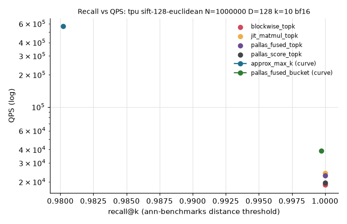

# tpu-retrieval-bench

Benchmark for exact top-k embedding retrieval on TPU. Question: when does a hand-written Pallas kernel beat stock XLA, and when is XLA already fast enough? Contract and sources: `docs/SPEC.md`, method: `docs/BENCHMARK_METHOD.md`.

## Variants

| id | name | what |
|---|---|---|
| V0 | `numpy_ref` | float64 NumPy oracle |
| V1 | `jit_topk` | `jax.jit` matmul then `lax.top_k` (baseline) |
| V2 | `blockwise` | scan over db blocks, per-block top-k, running merge |
| V3 | `pallas_score` | Pallas tiled score kernel (interpret mode on CPU), selection in JAX |
| A1 | `approx_max_k` | `lax.approx_max_k`, own recall-vs-QPS curve |
| stage | `score_only`, `select_only` | matmul and selection timed apart (selection over matmul ratio) |
| V4 | `pallas_fused_topk` | Pallas kernel fuses matmul and per-tile top-k (k <= 128); stage 2 `lax.top_k` over candidates. Exact. `kprime` option |
| V4b | `pallas_fused_bucket` | per-tile bucketed max over L lanes (TPU-KNN style), approximate, recall measured |

## Support matrix

What the tests and committed results show today. "CPU interpret" = pytest on CPU (Pallas in interpret mode: numerics only). "TPU v5e measured" = a committed record in `results/tpu/` from the Colab v5e-1 run. "GPU untested" = nothing was run on GPU. Not measured means not measured.

| variant | CPU interpret | TPU v5e measured | GPU |
|---|---|---|---|
| `jit_topk` | ip, l2, cos; mask; tested | ip (synthetic), l2 (SIFT-1M); no mask, no cos | untested |
| `blockwise` | ip, l2, cos; mask; tested | ip (synthetic), l2 (SIFT-1M); no mask, no cos | untested |
| `pallas_score` | ip, l2, cos; mask; tested; TPU lowering test from CPU | ip (synthetic), l2 (SIFT-1M); no mask, no cos; block sweep at N=1M, M in {128, 1024} | untested |
| `approx_max_k` | ip, no mask; recall tested at targets 0.9, 0.95, 0.99 | ip (synthetic), l2 (SIFT-1M); recall targets 0.80 to 0.99 (synthetic), 0.95 (SIFT) | untested |
| `pallas_fused_topk` (V4) | ip, l2, cos; mask; ties; non-aligned N/D; k <= 128; TPU lowering test from CPU | ip (synthetic), l2 (SIFT-1M); block sweep at N=1M | untested |
| `pallas_fused_bucket` (V4b) | recall tested (approximate); TPU lowering test from CPU | ip (synthetic), l2 (SIFT-1M); block sweep at N=1M | untested |

Mask support (`False` = excluded): `jit_topk`, `blockwise` and `pallas_score` are tested with a 30% mask on CPU; the benchmark CLI (`bench/cli.py`: `--algos`, `--m`, `--n`, `--d`, `--k`, `--metric`, `--dtype`, ...) has no mask argument, so no TPU record uses one. GPU: Pallas TPU kernels do not target GPU, and the XLA variants were never run there.

## Install

Not published to PyPI. Install from git, pinned to a release tag (or a commit):

```
pip install "trbench @ git+https://github.com/maxpetrusenko/tpu-retrieval-bench@v0.2.0"
```

For development and for rerunning the benchmark use a checkout and `uv sync --locked` (see Quickstart). The tag `v0.2.0` exists once the release is cut; until then use `@main`.

## Quickstart (CPU)

```
uv sync --extra hdf5 --extra plot
JAX_PLATFORMS=cpu uv run pytest -q
uv run ruff check .
uv run mypy
uv run python -m bench.run --algos jit_topk,blockwise,pallas_score,score_only,select_only --m 16 --n 65536 --d 128 --k 10
uv run python -m bench.download sift
uv run python -m bench.run --dataset sift-128-euclidean --n-train 100000 --n-test 1000 --algos jit_topk,blockwise
uv run python -m bench.plot
```

Results go to `results/<platform>/<dataset>/k<k>/<algo>/<params>.json`. CPU numbers only exercise the harness; they are not comparable to TPU numbers.

## Colab TPU

[Open the notebook in Colab](https://colab.research.google.com/github/maxpetrusenko/tpu-retrieval-bench/blob/main/notebooks/colab_tpu.ipynb) and pick a TPU v5e-1 runtime. The notebook checks out the pinned release tag (`REF`), installs the locked dependency versions (`notebooks/constraints.txt`) and runs `PYTHON=python3 bash scripts/reproduce_all.sh results/tpu/run-<date>`, the same single command for a local TPU host: full grid, block and recall sweeps, device time, then `validate_results --strict` and `summarize`. Records carry stdev and bootstrap 95% CIs from 20 repetitions; `bench/run.py` refuses a dirty git tree unless `--allow-dirty`.

## Results

TPU v5e-1 (free Colab, jax 0.12.0.1), k=10, bf16, N up to 1M, D=128. Three runs: Run 1 (unfused kernels, 2026-11-18), Run 2 (fused kernels, block sweeps, loop and device timing, 2026-11-21) and Run 3 (clean rerun, 2026-11-22). Full report: [docs/RESULTS.md](docs/RESULTS.md). The numbers below are Run 3: commit 0945fb1, 121 records, 0 dirty, 20 repetitions each, headline = median pass, plots from Run 3.

- Stock XLA (`jit_matmul_topk`) beat the unfused Pallas scoring kernel at every default shape except one tie (1.00x at N=1M, M=128, within noise; 0.50x to 0.93x elsewhere).
- Selection dominates: `sel/matmul` is 3.61 (N=1M, M=128), 6.48 (N=1M, M=1024) and 8.18 on SIFT-1M; no exact variant passed 3.9% of peak. The 27x claim did not reproduce at k=10.
- Fusing selection into the kernel helped at M=1024: exact `pallas_fused_topk` was 1.19x jit at N=65,536, and at N=1M 1.03x at the default config (23,414 vs 22,739 QPS) and 1.31x tuned (bn=1024, 29,722 QPS). At M=128 it lost even tuned (0.97x). The approximate `pallas_fused_bucket` was 1.23x to 1.83x jit at M >= 128 on synthetic data (1.41x and 1.76x at N=1M by default, 2.37x tuned at M=1024, 53,943 QPS), 1.62x on SIFT-1M (recall 0.9997). Both fused wins pass the CI noise check; at M <= 16 every Pallas variant is slower than jit.
- Block size: 6% to 7% for the scoring kernel, 2.3x to 4.9x (fused_topk) and 1.5x to 2.1x (fused_bucket) best over worst; bn=1024 was best in all four fused sweeps.
- `approx_max_k` at recall target 0.95: 565,089 QPS on SIFT-1M at recall 0.9802, 23.4x the exact baseline (24,120 QPS), 75.7% of peak on synthetic N=1M, M=1024 (579,189 QPS, 25.5x). The recall-target sweep (0.80 to 0.99) kept recall at 1.0 and moved QPS by 5.4%; it is not a recall curve.
- Wall timing carries a 0.32 to 0.60 ms per-call overhead (device time, N=1M), 47% of an `approx_max_k` call at M=128.
- Run 3 reproduced Run 2 within 2% on the best pass at N=1M, M >= 128 and SIFT-1M; small shapes moved up to 36% between sessions, which the within-run CIs do not show. **Low confidence:** every claim at small shapes (N=65,536, and M <= 16 at any N) rests on one session per run and can move by tens of percent in another; treat those ratios as indicative. The large-shape claims (N=1M, M >= 128, SIFT-1M) held within 2%.
- Not measured yet: matmul-only block sweep, recall-versus-QPS curve on real data, GloVe and GIST.



## Cite

If you use this benchmark or its numbers, cite it through [CITATION.cff](CITATION.cff); GitHub's "Cite this repository" button reads the same file. Quote numbers from a committed result JSON and name the chip, jax version and commit.

## Quality

The maintainer checklist for code, CI, reproducibility and security, with the checks behind each criterion and the independent review log, is [docs/QUALITY.md](docs/QUALITY.md).
