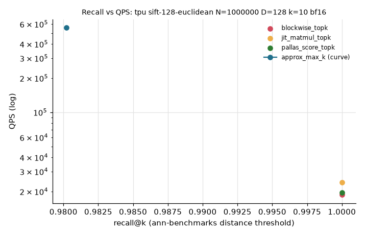
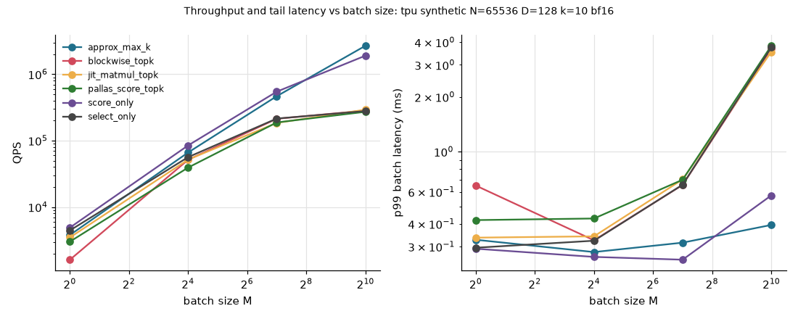

# Results: TPU v5e-1

read_when: quoting a TPU number from this repo, or deciding whether a Pallas kernel is worth writing for retrieval.
Method: `docs/BENCHMARK_METHOD.md`. Spec and claims under test: `docs/SPEC.md`, `docs/presearch/papers.md`. Raw data: `results/tpu/**/*.json`. Every number below comes from those JSON files, from the profiler trace in `results/profile_jit_topk_m128_n1e6_d128/`, or is arithmetic on them (marked "derived").

## 1. Setup

| item | value |
|---|---|
| Hardware | one TPU v5e chip, `device_kind` "TPU v5 lite", 1 device |
| Runtime | free Colab, v5e-1 runtime |
| Date | 2026-11-18, UTC; records created 13:31 to 13:36 UTC, profile 13:37 |
| Software | python 3.13.18, jax 0.12.0.1, jaxlib 0.12.0.1, libtpu 0.0.50 |
| Code | commit 52551c9 (`dirty: false`) |
| Peak used for "% of peak" | 197 TFLOP/s bf16 per TensorCore (JAX Pallas docs), HBM 820 GB/s |
| Synthetic | seeded Gaussian, D=128, k=10, bf16 compute, inner product, N in {65,536, 1,000,000}, M in {1, 16, 128, 1024} |
| SIFT-1M | ann-benchmarks `sift-128-euclidean`, N=1,000,000, D=128, L2, k=10, first 1000 test queries, one batch of 1000, bf16 compute |
| Protocol | 3 warmup calls, 5 timed repetitions, `block_until_ready`, database resident on device, host-to-device and device-to-host excluded. QPS = M / min time. With 5 repetitions p95 is effectively the max. |

Variants: `jit_matmul_topk` is V1 (full `Q @ E.T` then `lax.top_k`), `blockwise_topk` is V2 (65,536-column blocks, running merge), `pallas_score_topk` is V3 (Pallas scoring kernel, selection in JAX), `approx_max_k` is A1, `score_only` and `select_only` time the two stages apart. Pallas ran with one config per shape (bm = min(M, 256) rounded to 16, bn=512, bk=128); there was no block sweep (section 5).

## 2. Results

Per shape, one row per algorithm. `% peak` is achieved FLOP/s over the bf16 peak for the whole call. `sel/matmul` is the best `select_only` time over the best `score_only` time for the same shape, stored on the two stage rows. The roofline label is the rule-based label from `src/trbench/roofline.py`, not a hardware counter reading (see "Things that look wrong").

#### tpu / sift-128-euclidean / N=1000000 D=128 k=10 M=1000

| algo | compile_s | p50 ms | p95 ms | QPS | recall | recall eps0.01 | % peak | roofline | sel/matmul |
|---|---|---|---|---|---|---|---|---|---|
| approx_max_k (target 0.95) | 0.745 | 1.797 | 1.802 | 558188 | 0.9802 | 0.9803 | 72.54 | HBM-bound | - |
| blockwise_topk | 0.482 | 53.558 | 53.743 | 18718 | 1.0000 | 1.0000 | 2.43 | VPU/COP-bound | - |
| jit_matmul_topk | 0.641 | 41.597 | 41.739 | 24093 | 1.0000 | 1.0000 | 3.13 | VPU/COP-bound | - |
| pallas_score_topk (bm256,bn512,bk128) | 0.545 | 51.017 | 51.090 | 19632 | 1.0000 | 1.0000 | 2.55 | VPU/COP-bound | - |
| score_only | 0.211 | 6.247 | 6.287 | 160918 | - | - | 20.91 | HBM-bound | 8.16 |
| select_only | 0.859 | 50.821 | 50.859 | 19716 | - | - | - | VPU/COP-bound | 8.16 |

#### tpu / synthetic / N=65536 D=128 k=10 M=1

| algo | compile_s | p50 ms | p95 ms | QPS | recall | recall eps0.01 | % peak | roofline | sel/matmul |
|---|---|---|---|---|---|---|---|---|---|
| approx_max_k (target 0.95) | 0.163 | 0.295 | 0.324 | 3801 | 0.9000 | - | 0.03 | HBM-bound | - |
| blockwise_topk | 0.633 | 0.640 | 0.649 | 1613 | 1.0000 | - | 0.01 | VPU/COP-bound | - |
| jit_matmul_topk | 0.145 | 0.305 | 0.333 | 3492 | 1.0000 | - | 0.03 | VPU/COP-bound | - |
| pallas_score_topk (bm16,bn512,bk128) | 0.269 | 0.402 | 0.418 | 3018 | 1.0000 | - | 0.03 | VPU/COP-bound | - |
| score_only | 0.128 | 0.227 | 0.283 | 4911 | - | - | 0.04 | HBM-bound | 1.10 |
| select_only | 0.061 | 0.259 | 0.290 | 4450 | - | - | - | VPU/COP-bound | 1.10 |

#### tpu / synthetic / N=65536 D=128 k=10 M=16

| algo | compile_s | p50 ms | p95 ms | QPS | recall | recall eps0.01 | % peak | roofline | sel/matmul |
|---|---|---|---|---|---|---|---|---|---|
| approx_max_k (target 0.95) | 0.196 | 0.261 | 0.277 | 66288 | 1.0000 | - | 0.56 | HBM-bound | - |
| blockwise_topk | 0.350 | 0.314 | 0.325 | 51487 | 1.0000 | - | 0.44 | VPU/COP-bound | - |
| jit_matmul_topk | 0.214 | 0.315 | 0.338 | 51844 | 1.0000 | - | 0.44 | VPU/COP-bound | - |
| pallas_score_topk (bm16,bn512,bk128) | 0.280 | 0.415 | 0.428 | 39306 | 1.0000 | - | 0.33 | VPU/COP-bound | - |
| score_only | 0.192 | 0.234 | 0.260 | 84679 | - | - | 0.72 | HBM-bound | 1.50 |
| select_only | 0.193 | 0.291 | 0.321 | 56437 | - | - | - | VPU/COP-bound | 1.50 |

#### tpu / synthetic / N=65536 D=128 k=10 M=128

| algo | compile_s | p50 ms | p95 ms | QPS | recall | recall eps0.01 | % peak | roofline | sel/matmul |
|---|---|---|---|---|---|---|---|---|---|
| approx_max_k (target 0.95) | 0.295 | 0.296 | 0.314 | 466167 | 0.9969 | - | 3.97 | HBM-bound | - |
| blockwise_topk | 0.311 | 0.616 | 0.650 | 213241 | 1.0000 | - | 1.82 | VPU/COP-bound | - |
| jit_matmul_topk | 0.240 | 0.700 | 0.702 | 184696 | 1.0000 | - | 1.57 | VPU/COP-bound | - |
| pallas_score_topk (bm128,bn512,bk128) | 0.277 | 0.687 | 0.699 | 187683 | 1.0000 | - | 1.60 | VPU/COP-bound | - |
| score_only | 0.166 | 0.248 | 0.253 | 545703 | - | - | 4.65 | HBM-bound | 2.54 |
| select_only | 0.734 | 0.616 | 0.657 | 214780 | - | - | - | VPU/COP-bound | 2.54 |

#### tpu / synthetic / N=65536 D=128 k=10 M=1024

| algo | compile_s | p50 ms | p95 ms | QPS | recall | recall eps0.01 | % peak | roofline | sel/matmul |
|---|---|---|---|---|---|---|---|---|---|
| approx_max_k (target 0.95) | 0.546 | 0.388 | 0.394 | 2675026 | 0.9969 | - | 22.78 | HBM-bound | - |
| blockwise_topk | 0.412 | 3.638 | 3.669 | 283043 | 1.0000 | - | 2.41 | VPU/COP-bound | - |
| jit_matmul_topk | 0.197 | 3.523 | 3.536 | 292273 | 1.0000 | - | 2.49 | VPU/COP-bound | - |
| pallas_score_topk (bm256,bn512,bk128) | 0.366 | 3.782 | 3.818 | 271392 | 1.0000 | - | 2.31 | VPU/COP-bound | - |
| score_only | 0.159 | 0.544 | 0.571 | 1898089 | - | - | 16.16 | HBM-bound | 6.81 |
| select_only | 0.726 | 3.717 | 3.738 | 278669 | - | - | - | VPU/COP-bound | 6.81 |

#### tpu / synthetic / N=1000000 D=128 k=10 M=1

| algo | compile_s | p50 ms | p95 ms | QPS | recall | recall eps0.01 | % peak | roofline | sel/matmul |
|---|---|---|---|---|---|---|---|---|---|
| approx_max_k (target 0.95) | 0.138 | 0.671 | 0.678 | 1502 | 1.0000 | - | 0.20 | HBM-bound | - |
| blockwise_topk | 0.233 | 0.853 | 0.864 | 1181 | 1.0000 | - | 0.15 | HBM-bound | - |
| jit_matmul_topk | 1.219 | 0.875 | 1.361 | 1198 | 1.0000 | - | 0.16 | HBM-bound | - |
| pallas_score_topk (bm16,bn512,bk128) | 0.349 | 1.696 | 1.710 | 601 | 1.0000 | - | 0.08 | HBM-bound | - |
| score_only | 0.140 | 0.590 | 0.607 | 1741 | - | - | 0.23 | HBM-bound | 0.77 |
| select_only | 1.273 | 0.454 | 0.478 | 2248 | - | - | - | HBM-bound | 0.77 |

#### tpu / synthetic / N=1000000 D=128 k=10 M=16

| algo | compile_s | p50 ms | p95 ms | QPS | recall | recall eps0.01 | % peak | roofline | sel/matmul |
|---|---|---|---|---|---|---|---|---|---|
| approx_max_k (target 0.95) | 0.130 | 0.647 | 0.689 | 25129 | 0.9938 | - | 3.27 | HBM-bound | - |
| blockwise_topk | 0.263 | 1.365 | 1.378 | 11737 | 1.0000 | - | 1.53 | VPU/COP-bound | - |
| jit_matmul_topk | 0.675 | 1.165 | 1.242 | 13780 | 1.0000 | - | 1.79 | VPU/COP-bound | - |
| pallas_score_topk (bm16,bn512,bk128) | 0.298 | 1.685 | 1.709 | 9587 | 1.0000 | - | 1.25 | VPU/COP-bound | - |
| score_only | 0.128 | 0.664 | 0.668 | 24273 | - | - | 3.15 | HBM-bound | 1.40 |
| select_only | 0.622 | 0.926 | 0.934 | 17399 | - | - | - | VPU/COP-bound | 1.40 |

#### tpu / synthetic / N=1000000 D=128 k=10 M=128

| algo | compile_s | p50 ms | p95 ms | QPS | recall | recall eps0.01 | % peak | roofline | sel/matmul |
|---|---|---|---|---|---|---|---|---|---|
| approx_max_k (target 0.95) | 0.307 | 0.664 | 0.679 | 197861 | 0.9969 | - | 25.71 | HBM-bound | - |
| blockwise_topk | 0.284 | 5.834 | 5.897 | 21988 | 1.0000 | - | 2.86 | VPU/COP-bound | - |
| jit_matmul_topk | 0.867 | 6.194 | 6.209 | 20680 | 1.0000 | - | 2.69 | VPU/COP-bound | - |
| pallas_score_topk (bm128,bn512,bk128) | 0.326 | 6.203 | 6.250 | 20857 | 1.0000 | - | 2.71 | VPU/COP-bound | - |
| score_only | 0.112 | 1.398 | 1.402 | 91819 | - | - | 11.93 | HBM-bound | 3.59 |
| select_only | 0.889 | 5.076 | 5.109 | 25601 | - | - | - | VPU/COP-bound | 3.59 |

#### tpu / synthetic / N=1000000 D=128 k=10 M=1024

| algo | compile_s | p50 ms | p95 ms | QPS | recall | recall eps0.01 | % peak | roofline | sel/matmul |
|---|---|---|---|---|---|---|---|---|---|
| approx_max_k (target 0.95) | 0.401 | 1.849 | 1.860 | 557807 | 1.0000 | - | 72.49 | HBM-bound | - |
| blockwise_topk | 0.448 | 53.771 | 53.812 | 19048 | 1.0000 | - | 2.48 | VPU/COP-bound | - |
| jit_matmul_topk | 0.885 | 45.094 | 45.356 | 22803 | 1.0000 | - | 2.96 | VPU/COP-bound | - |
| pallas_score_topk (bm256,bn512,bk128) | 0.497 | 51.152 | 51.265 | 20036 | 1.0000 | - | 2.60 | VPU/COP-bound | - |
| score_only | 0.140 | 7.084 | 7.104 | 145198 | - | - | 18.87 | HBM-bound | 5.38 |
| select_only | 1.029 | 38.117 | 38.191 | 26983 | - | - | - | VPU/COP-bound | 5.38 |

### Pallas block sensitivity

| shape | configs | best bm x bn x bk | best QPS | worst config | worst QPS | best/worst |
|---|---|---|---|---|---|---|
| tpu / sift-128-euclidean / N=1000000 D=128 k=10 M=1000 | 1 | 256x512x128 | 19632 | 256x512x128 | 19632 | 1.000 |
| tpu / synthetic / N=65536 D=128 k=10 M=1 | 1 | 16x512x128 | 3018 | 16x512x128 | 3018 | 1.000 |
| tpu / synthetic / N=65536 D=128 k=10 M=16 | 1 | 16x512x128 | 39306 | 16x512x128 | 39306 | 1.000 |
| tpu / synthetic / N=65536 D=128 k=10 M=128 | 1 | 128x512x128 | 187683 | 128x512x128 | 187683 | 1.000 |
| tpu / synthetic / N=65536 D=128 k=10 M=1024 | 1 | 256x512x128 | 271392 | 256x512x128 | 271392 | 1.000 |
| tpu / synthetic / N=1000000 D=128 k=10 M=1 | 1 | 16x512x128 | 601 | 16x512x128 | 601 | 1.000 |
| tpu / synthetic / N=1000000 D=128 k=10 M=16 | 1 | 16x512x128 | 9587 | 16x512x128 | 9587 | 1.000 |
| tpu / synthetic / N=1000000 D=128 k=10 M=128 | 1 | 128x512x128 | 20857 | 128x512x128 | 20857 | 1.000 |
| tpu / synthetic / N=1000000 D=128 k=10 M=1024 | 1 | 256x512x128 | 20036 | 256x512x128 | 20036 | 1.000 |

### Flags

none

### Key numbers (QPS, exact variants and approx_max_k at target 0.95)

| shape (N, M) | jit_matmul_topk | blockwise_topk | pallas_score_topk | approx_max_k | sel/matmul |
|---|---|---|---|---|---|
| 65,536, 1 | 3,492 | 1,613 | 3,018 | 3,801 | 1.10 |
| 65,536, 16 | 51,844 | 51,487 | 39,306 | 66,288 | 1.50 |
| 65,536, 128 | 184,696 | 213,241 | 187,683 | 466,167 | 2.54 |
| 65,536, 1024 | 292,273 | 283,043 | 271,392 | 2,675,026 | 6.81 |
| 1,000,000, 1 | 1,198 | 1,181 | 601 | 1,502 | 0.77 |
| 1,000,000, 16 | 13,780 | 11,737 | 9,587 | 25,129 | 1.40 |
| 1,000,000, 128 | 20,680 | 21,988 | 20,857 | 197,861 | 3.59 |
| 1,000,000, 1024 | 22,803 | 19,048 | 20,036 | 557,807 | 5.38 |
| SIFT-1M, 1000 | 24,093 | 18,718 | 19,632 | 558,188 (recall 0.980) | 8.16 |

## 3. Plots

TPU only, generated with `python -m bench.plot --platform tpu`. Only the best-QPS record per (algorithm, batch size) is drawn.






The other four plots (`tpu_percent_of_peak_*` for SIFT and N=65,536, `tpu_recall_qps_*` for synthetic) are in `docs/img/`. The recall plots show points, not a curve: `approx_max_k` ran at one recall target.

## 4. HLO and trace evidence

Two kinds of evidence, labeled by what they are.

### 4a. Compiled: device trace of `jit_topk`, M=128, N=1,000,000, D=128, k=10 (from the TPU run)

Source: `results/profile_jit_topk_m128_n1e6_d128/` (XProf trace; text digest in `results/tpu/lowered/profile_jit_topk_m128_n1e6_d128.device_ops.txt`, made with `python -m bench.trace_ops`). This is the compiled program as it ran on the chip. It has two device ops:

```
[XLA Modules] jit__lambda: 6199.1 us
[XLA Ops] fusion:      1557.5 us  bytes_accessed=1024065536  category=convolution fusion
  %fusion = f32[128,1000000] fusion(f32[1000000,128] %e.1, f32[128,128] %q.1), kind=kOutput
[XLA Ops] custom-call: 4641.4 us  bytes_accessed=512010240   category=custom-call
  %custom-call = (f32[128,10], s32[128,10]) custom-call(f32[128,1000000] %fusion),
      custom_call_target="TopK"
```

- The matmul and the selection are separate ops. The 128 x 1,000,000 f32 score matrix (512 MB) is written by the fusion and read back by the `TopK` custom call. XLA did not fuse them.
- Selection is 4641.4 us of 6199.1 us module time (75%, derived), 2.98x the matmul fusion (derived). The harness stage split for this shape says 3.59x (`sel/matmul`); the two differ because the stage functions are separate jitted programs.
- Derived bandwidth: the fusion moves 1.024 GB in 1.557 ms (658 GB/s, 80% of 820 GB/s); `TopK` reads 0.512 GB in 4.641 ms (110 GB/s, 13%). The matmul fusion is close to HBM-bound; `TopK` is slow without being bandwidth-limited, which is the compute-side (vector unit) cost TPU-KNN describes. The trace does not give a VPU counter, so that attribution is inference.
- The module time matches the wall-clock record for the same shape in the sweep (`jit_matmul_topk`, M=128, N=1e6: p50 6.194 ms).

### 4b. Lowered, not compiled: StableHLO for TPU, produced on CPU

Produced with `python -m bench.dump_lowered --m 128 --n 1000000 --d 128 --k 10` using `.trace(...).lower(lowering_platforms=("tpu",)).as_text()`. Full text in `results/tpu/lowered/*.stablehlo.txt`. This is the program JAX asks XLA and Mosaic to build. It is not the optimized HLO and says nothing about fusion or scheduling on the TPU.

`jit_topk` (the whole module):

```
%0 = stablehlo.convert %arg0 : (tensor<128x128xf32>) -> tensor<128x128xbf16>
%1 = stablehlo.transpose %arg1, dims = [1, 0] : (tensor<1000000x128xbf16>) -> tensor<128x1000000xbf16>
%2 = stablehlo.dot_general %0, %1, contracting_dims = [1] x [0] : (...) -> tensor<128x1000000xf32>
%values, %indices = chlo.top_k(%2, k = 10) : tensor<128x1000000xf32> -> (tensor<128x10xf32>, tensor<128x10xi32>)
```

`pallas_score` (excerpt; the base64 Mosaic payload in `backend_config` is cut). 15 full chunks of 65,536 columns run inside a `stablehlo.while`, then one 17,408-column remainder:

```
%7:7 = stablehlo.while(...)
  cond: iterArg_9 < 15
  do:
    %17 = stablehlo.custom_call @tpu_custom_call(%iterArg_8, %14, %15) {backend_config = "{...custom_call_config...}"}
          : (tensor<128x128xbf16>, tensor<65536x128xbf16>, tensor<8x65536xf32>) -> tensor<128x65536xf32>
    %values_12, %indices_13 = chlo.top_k(%17, k = 10) : tensor<128x65536xf32> -> (tensor<128x10xf32>, tensor<128x10xi32>)
    ... merge: chlo.top_k over the 20 running + block candidates -> 10
%8 = stablehlo.custom_call @tpu_custom_call(%1, %arg3, %arg4) ... -> tensor<128x17408xf32>   (remainder chunk)
%values, %indices = chlo.top_k(%8, k = 10) : tensor<128x17408xf32> -> ...
```

Mosaic accepted the kernel on the real chip (the Pallas runs completed with recall 1.0). The Pallas program differs from the XLA one only in how the scores are produced: a hand-tiled `tpu_custom_call` writing each 128 x 65,536 score tile to HBM, followed by the same `top_k`. Selection is unchanged, so selection cost is unchanged.

## 5. What we found

**Did Pallas beat XLA?** Rarely, and never by a margin that separates from noise. `pallas_score_topk` over `jit_matmul_topk` QPS (derived): 1.016 at (N=65,536, M=128) and 1.009 at (N=1M, M=128); every other shape is below 1: 0.93 and 0.88 at M=1024, 0.76 and 0.70 at M=16, 0.86 and 0.50 at M=1, 0.81 on SIFT-1M. The two wins are within 2%. Against `blockwise_topk`, which has the same selection but an XLA matmul, Pallas is ahead by 5% at (N=1M, M=1024) and behind at the other seven shapes (0.51 to 0.96). The exception is (N=65,536, M=1), 1.87x, where `blockwise_topk` is anomalously slow (section 6).

**When did XLA win?** Most of the time. Best exact variant by QPS: `jit_matmul_topk` in 7 of 9 shapes (all M=1, M=16 and M=1024 shapes, and SIFT-1M), `blockwise_topk` in the two M=128 shapes (+15% at N=65,536, +6% at N=1M over jit), Pallas in none. Pallas lost worst at small M: at M=1 it pads the query block to 16 rows, and the 1M-row shape ran at 601 QPS against 1,198 for XLA. Why XLA wins follows from the data: the whole pipeline is dominated by selection (next point), and Pallas replaces only the matmul, the cheap part. The matmul stage alone (`score_only`, XLA) takes 7.05 ms of a 44.9 ms call at (N=1M, M=1024).

**Is selection the bottleneck?** Yes at M >= 128, no at M=1. `sel/matmul` (best `select_only` over best `score_only`): 0.77 and 1.10 at M=1, 1.40 and 1.50 at M=16, 3.59 and 2.54 at M=128, 5.38 (N=1M) and 6.81 (N=65,536) at M=1024, 8.16 on SIFT-1M with k=10. That is selection at about 44% to 89% of matmul-plus-selection time (derived). The ratio grows with M because the matmul amortizes its fixed cost and `top_k` work scales with M x N. The best-of-5 time of the fused `jit_matmul_topk` call equals the sum of its two stage times within 1% at (N=1M, M=1024): 44.907 ms against 45.003 ms (derived), so nothing overlaps. We did not reproduce the 27x of Samaga et al. The largest ratio we measured is 8.16, a third of that. The shapes are not the same: their 27x is a top-2% selection over Gemma FFN activations (k in the thousands), ours is k=10 over 65,536 to 1,000,000 columns, and selection cost grows with k. The direction matches (selection costs several times the matmul), the magnitude does not transfer.

**What % of peak did each reach?** Exact variants: 3.13% at best (`jit_matmul_topk` on SIFT-1M), 2.96% on synthetic (N=1M, M=1024), 2.5% and 2.6% for blockwise and Pallas at (N=1M, M=1024). `approx_max_k`: 72.5% at (N=1M, M=1024) and on SIFT-1M, which is 142.8 TFLOP/s achieved at the synthetic shape. `score_only` (XLA matmul plus writing the score matrix): 18.9% at (N=1M, M=1024) and 20.9% on SIFT, with the modeled HBM traffic (4 GB of scores written) at 75% and 84% of 820 GB/s (derived from `bytes_moved`). This supports the TPU-KNN claim for exact search: with selection done by `top_k`, no exact variant here is anywhere near peak, and the reason is selection, since the matmul stage alone already uses about 75% of modeled HBM bandwidth. It also supports their other claim that approximate aggregation can run at a large fraction of peak. At small M every variant is below 1% of peak or near it, because the call is launch-bound (see Limitations).

**Block-size sensitivity.** Not measured. The notebook did not pass `--sweep-blocks`, so each shape has exactly one Pallas config and best/worst is the same record (best/worst = 1.000 everywhere in the table above). The claim being tested (128-cube blocks at about 6% of peak against 512x1024x1024 at about 78% to 92% in the JAX matmul guide) is also not testable from these records even with a sweep, because they time the Pallas kernel inside the full pipeline, not the Pallas matmul alone. What the data does show: the default Pallas config (256x512x128) lands at 2.3% to 2.7% of peak in the pipeline at M >= 128, indistinguishable from XLA, because selection hides the matmul. The optional notebook cell added in this change runs the sweep (`--sweep-blocks`, M in {128, 1024}).

**`approx_max_k` recall and QPS.** Only target 0.95 was run, so there is no recall-versus-QPS curve. At that target: SIFT-1M recall 0.9802 (0.9803 at epsilon 0.01) at 558,188 QPS, 23.2x the exact `jit_matmul_topk` (24,093 QPS) on the same data. On synthetic data recall was 0.99375 to 1.0 for M >= 16 and 0.9 at M=1, where each query contributes ten neighbors, so 0.9 is one miss. Speedup over `jit_matmul_topk` grows with M: 1.1x to 1.3x at M=1, 1.3x to 1.8x at M=16, 2.5x to 9.6x at M=128, 9.2x to 24.5x at M=1024. At the largest shapes `approx_max_k` is the only variant that gets to a large share of peak (72.5%), because its compiled path very likely avoids the exact `TopK` pass (not checked: no trace was taken for it). This holds only above the 0.95 target recall; the recall cost at lower targets and larger k is not measured here.

**SIFT-1M.** Exact variants reached recall 1.0 (and 1.0 at epsilon 0.01) with bf16 compute. `jit_matmul_topk`: 24,093 QPS, p50 41.6 ms per 1000 queries. `pallas_score_topk` 19,632 (0.81x), `blockwise_topk` 18,718 (0.78x). `select_only` is 50.8 ms against 6.25 ms for `score_only`, ratio 8.16, higher than the synthetic N=1M, M=1024 ratio of 5.38 even though M is similar. We have not isolated why (L2 epilogue and real score distributions are both candidates; the `select_only` input in this run was not inspected). GloVe-100 and GIST-960 were not run.

**Not testable here: fused vs unfused.** The Faiss claim (fused at least 25% faster) needs a fused matmul plus top-k kernel; V4 is not built. Section 4a does show the unfused structure on TPU: matmul fusion, then a `TopK` custom call that re-reads the 512 MB score matrix. Reading it from HBM at 820 GB/s would take about 0.62 ms (derived), against 4.64 ms measured, so for k=10 the extra HBM pass is a small part of the selection cost; the selection compute is the larger cost. That points to the 25% claim being a GPU-side result that may not carry over, but a fused kernel is the only real test.

## 6. Things that look wrong or need care

- Roofline labels are rule-based. Every exact variant is labeled VPU/COP-bound because measured selection time exceeds matmul time, with no VPU counter involved. `approx_max_k` is labeled HBM-bound at 72.5% of peak, because the model charges it for writing and re-reading the full score matrix, which the compiled path very likely does not do. Read `percent_of_peak` and `sel/matmul`, not the label, for `approx_max_k`.
- `approx_max_k` recall 0.9 at (N=65,536, M=1) is below the 0.95 target. That is ten neighbors from one query (9 of 10), not a bug.
- `blockwise_topk` at (N=65,536, M=1) runs at 0.640 ms against 0.305 ms for `jit_matmul_topk`, with N equal to one block. We have no explanation; the block scan wrapper and merge of 20 candidates is the likely cost.
- Small-shape timings are launch-bound. `score_only` at M=1, N=65,536 takes 0.227 ms for about 17 MFLOP, and nearly every M <= 16 stage sits between 0.2 and 0.7 ms. Wall-clock timing includes dispatch (BENCHMARK_METHOD.md), so these rows measure the floor, not the kernel.
- The Pallas `bk` is 128, not the 512 default, because the kernel clamps `bk` to D rounded up to 128 for D=128. Filenames show `bk128`.
- No errors were recorded in any JSON, no exact variant had recall below 1.0, and no record exceeded 100% of peak. Compile times ran from 0.061 s to 1.273 s; the largest p95/p50 ratio is 1.56 (a `jit_matmul_topk` M=1 N=1M record, where a 1.361 ms p95 sits against 0.875 ms p50).
- The notebook's device-check cell imported jax in the kernel and locked the TPU, and `bench/download.py` got HTTP 403 from ann-benchmarks with the default urllib User-Agent. Both are fixed in the same change as this report. The SIFT file came down through `curl` in a scratch cell  (a scratch cell showed curl progress output), not through the fixed script.

## 7. Limitations

- One chip (v5e-1), one run, one process, on the free Colab tier. Free-tier hosts vary and no run-to-run repeats were taken, so differences under a few percent (the two Pallas "wins") are not distinguishable from noise.
- Five repetitions per record; p95 and p99 are effectively the maximum.
- Narrow sweep: D=128 only, k=10 only, bf16 and inner product (synthetic) or L2 (SIFT) only, N in {65,536, 1M}. No f32, no k=100, no non-power-of-two or non-128-multiple D, no GloVe or GIST. SIFT used 1000 queries, not the 10,000 in the file.
- Pallas: one block config per shape, no block sweep, no isolated Pallas matmul timing, no fused top-k kernel.
- `approx_max_k`: one recall target.
- Only `jit_topk` was profiled, at one shape. No compiled HLO dump (`--dump-hlo`) was taken; section 4b is lowered StableHLO from CPU.
- CPU numbers (CI, Mac mini) and Pallas interpret-mode runs are not comparable to anything here and are not in this report.
- Peak figures come from the JAX Pallas documentation, not from a measurement on this chip.
