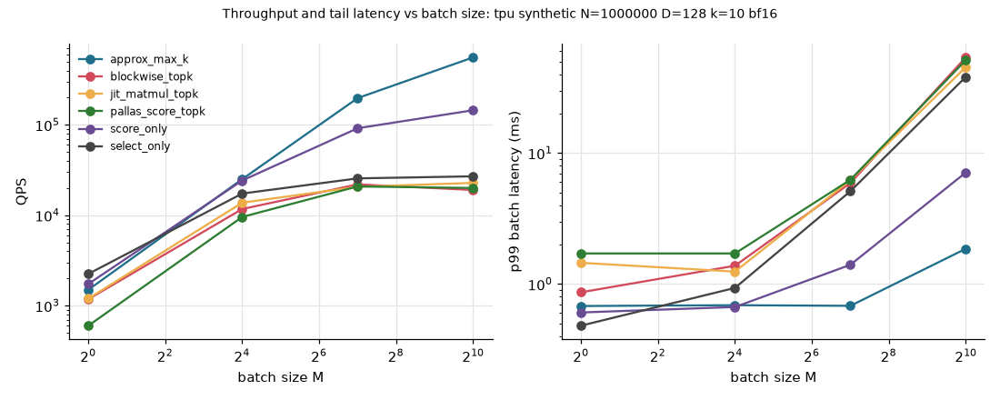
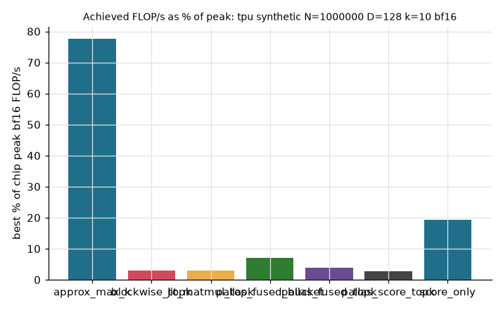

# Results: TPU v5e-1

read_when: quoting a TPU number from this repo, or deciding whether a Pallas kernel is worth writing for retrieval.
Method: `docs/BENCHMARK_METHOD.md`. Spec and claims under test: `docs/SPEC.md`, `docs/presearch/papers.md`. Raw data: `results/tpu/**/*.json` (Run 1 in `results/tpu/{synthetic,sift-128-euclidean}`, Run 2 in `results/tpu/run2*`, Run 3 in `results/tpu/run3*`). Every number below comes from those JSON files, from the profiler trace in `results/profile_jit_topk_m128_n1e6_d128/`, or is arithmetic on them (marked "derived").

> **Which run to quote.** Run 3 (section 9, 2026-11-22) supersedes Run 2 (section 8, 2026-11-21), which in turn extended Run 1 (sections 1 to 7, 2026-11-18). Run 3 is the same grid from a clean commit, 20 repetitions per record, schema 0.2 (median headline with a 95% CI), 0 dirty records, default and swept configs kept apart. Quote Run 3 numbers; where a Run 2 figure differs, Run 3's wins. The caveats in 8.7 and 8.8 are superseded by Run 3 except where noted there. Sections 1 to 7 describe Run 1: where they say "not measured", "V4 is not built" or "one recall target", sections 8 and 9 have the measurement.

> The plots in section 3 are from Run 3 (they were Run 1, then Run 2, before).

## Methodology note: QPS basis

Runs 1 and 2 are schema 0.1 records. Their headline QPS is M / min(time) over 5 timed repetitions, the best pass, and they carry no CI. Records from the next TPU run (schema 0.2, 20 repetitions) use the median pass as the headline `qps`, with a bootstrap 95% CI of that median and the fastest pass kept as `qps_best`. Do not divide a median-basis QPS by a best-pass QPS: `bench.summarize` and `bench.plot` compare on the best pass whenever a table mixes the two and label it. The full rule is in `docs/BENCHMARK_METHOD.md` section 2, items 4 and 6.

## 1. Setup

| item | value |
|---|---|
| Hardware | one TPU v5e chip, `device_kind` "TPU v5 lite", 1 device |
| Runtime | free Colab, v5e-1 runtime |
| Date | 2026-11-18, UTC; records created 13:31 to 13:36 UTC, profile 13:37 |
| Software | python 3.13.18, jax 0.12.0.1, jaxlib 0.12.0.1, libtpu 0.0.50 |
| Code | commit 52551c9 (`dirty: false`) |
| Peak used for "% of peak" | 197 TFLOP/s bf16 per TensorCore (JAX Pallas docs), HBM 820 GB/s |
| Synthetic | seeded Gaussian, D=128, k=10, bf16 compute, inner product, N in {65,536, 1,000,000}, M in {1, 16, 128, 1024} |
| SIFT-1M | ann-benchmarks `sift-128-euclidean`, N=1,000,000, D=128, L2, k=10, first 1000 test queries, one batch of 1000, bf16 compute |
| Protocol | 3 warmup calls, 5 timed repetitions, `block_until_ready`, database resident on device, host-to-device and device-to-host excluded. QPS = M / min time. With 5 repetitions p95 is effectively the max. |

Variants: `jit_matmul_topk` is V1 (full `Q @ E.T` then `lax.top_k`), `blockwise_topk` is V2 (65,536-column blocks, running merge), `pallas_score_topk` is V3 (Pallas scoring kernel, selection in JAX), `approx_max_k` is A1, `score_only` and `select_only` time the two stages apart. Pallas ran with one config per shape (bm = min(M, 256) rounded to 16, bn=512, bk=128); there was no block sweep (section 5).

## 2. Results

Per shape, one row per algorithm. `% peak` is achieved FLOP/s over the bf16 peak for the whole call. `sel/matmul` is the best `select_only` time over the best `score_only` time for the same shape, stored on the two stage rows. The roofline label is the rule-based label from `src/trbench/roofline.py`, not a hardware counter reading (see "Things that look wrong").

#### tpu / sift-128-euclidean / N=1000000 D=128 k=10 M=1000

| algo | compile_s | p50 ms | p95 ms | QPS | recall | recall eps0.01 | % peak | roofline | sel/matmul |
|---|---|---|---|---|---|---|---|---|---|
| approx_max_k (target 0.95) | 0.745 | 1.797 | 1.802 | 558188 | 0.9802 | 0.9803 | 72.54 | HBM-bound | - |
| blockwise_topk | 0.482 | 53.558 | 53.743 | 18718 | 1.0000 | 1.0000 | 2.43 | VPU/COP-bound | - |
| jit_matmul_topk | 0.641 | 41.597 | 41.739 | 24093 | 1.0000 | 1.0000 | 3.13 | VPU/COP-bound | - |
| pallas_score_topk (bm256,bn512,bk128) | 0.545 | 51.017 | 51.090 | 19632 | 1.0000 | 1.0000 | 2.55 | VPU/COP-bound | - |
| score_only | 0.211 | 6.247 | 6.287 | 160918 | - | - | 20.91 | HBM-bound | 8.16 |
| select_only | 0.859 | 50.821 | 50.859 | 19716 | - | - | - | VPU/COP-bound | 8.16 |

#### tpu / synthetic / N=65536 D=128 k=10 M=1

| algo | compile_s | p50 ms | p95 ms | QPS | recall | recall eps0.01 | % peak | roofline | sel/matmul |
|---|---|---|---|---|---|---|---|---|---|
| approx_max_k (target 0.95) | 0.163 | 0.295 | 0.324 | 3801 | 0.9000 | - | 0.03 | HBM-bound | - |
| blockwise_topk | 0.633 | 0.640 | 0.649 | 1613 | 1.0000 | - | 0.01 | VPU/COP-bound | - |
| jit_matmul_topk | 0.145 | 0.305 | 0.333 | 3492 | 1.0000 | - | 0.03 | VPU/COP-bound | - |
| pallas_score_topk (bm16,bn512,bk128) | 0.269 | 0.402 | 0.418 | 3018 | 1.0000 | - | 0.03 | VPU/COP-bound | - |
| score_only | 0.128 | 0.227 | 0.283 | 4911 | - | - | 0.04 | HBM-bound | 1.10 |
| select_only | 0.061 | 0.259 | 0.290 | 4450 | - | - | - | VPU/COP-bound | 1.10 |

#### tpu / synthetic / N=65536 D=128 k=10 M=16

| algo | compile_s | p50 ms | p95 ms | QPS | recall | recall eps0.01 | % peak | roofline | sel/matmul |
|---|---|---|---|---|---|---|---|---|---|
| approx_max_k (target 0.95) | 0.196 | 0.261 | 0.277 | 66288 | 1.0000 | - | 0.56 | HBM-bound | - |
| blockwise_topk | 0.350 | 0.314 | 0.325 | 51487 | 1.0000 | - | 0.44 | VPU/COP-bound | - |
| jit_matmul_topk | 0.214 | 0.315 | 0.338 | 51844 | 1.0000 | - | 0.44 | VPU/COP-bound | - |
| pallas_score_topk (bm16,bn512,bk128) | 0.280 | 0.415 | 0.428 | 39306 | 1.0000 | - | 0.33 | VPU/COP-bound | - |
| score_only | 0.192 | 0.234 | 0.260 | 84679 | - | - | 0.72 | HBM-bound | 1.50 |
| select_only | 0.193 | 0.291 | 0.321 | 56437 | - | - | - | VPU/COP-bound | 1.50 |

#### tpu / synthetic / N=65536 D=128 k=10 M=128

| algo | compile_s | p50 ms | p95 ms | QPS | recall | recall eps0.01 | % peak | roofline | sel/matmul |
|---|---|---|---|---|---|---|---|---|---|
| approx_max_k (target 0.95) | 0.295 | 0.296 | 0.314 | 466167 | 0.9969 | - | 3.97 | HBM-bound | - |
| blockwise_topk | 0.311 | 0.616 | 0.650 | 213241 | 1.0000 | - | 1.82 | VPU/COP-bound | - |
| jit_matmul_topk | 0.240 | 0.700 | 0.702 | 184696 | 1.0000 | - | 1.57 | VPU/COP-bound | - |
| pallas_score_topk (bm128,bn512,bk128) | 0.277 | 0.687 | 0.699 | 187683 | 1.0000 | - | 1.60 | VPU/COP-bound | - |
| score_only | 0.166 | 0.248 | 0.253 | 545703 | - | - | 4.65 | HBM-bound | 2.54 |
| select_only | 0.734 | 0.616 | 0.657 | 214780 | - | - | - | VPU/COP-bound | 2.54 |

#### tpu / synthetic / N=65536 D=128 k=10 M=1024

| algo | compile_s | p50 ms | p95 ms | QPS | recall | recall eps0.01 | % peak | roofline | sel/matmul |
|---|---|---|---|---|---|---|---|---|---|
| approx_max_k (target 0.95) | 0.546 | 0.388 | 0.394 | 2675026 | 0.9969 | - | 22.78 | HBM-bound | - |
| blockwise_topk | 0.412 | 3.638 | 3.669 | 283043 | 1.0000 | - | 2.41 | VPU/COP-bound | - |
| jit_matmul_topk | 0.197 | 3.523 | 3.536 | 292273 | 1.0000 | - | 2.49 | VPU/COP-bound | - |
| pallas_score_topk (bm256,bn512,bk128) | 0.366 | 3.782 | 3.818 | 271392 | 1.0000 | - | 2.31 | VPU/COP-bound | - |
| score_only | 0.159 | 0.544 | 0.571 | 1898089 | - | - | 16.16 | HBM-bound | 6.81 |
| select_only | 0.726 | 3.717 | 3.738 | 278669 | - | - | - | VPU/COP-bound | 6.81 |

#### tpu / synthetic / N=1000000 D=128 k=10 M=1

| algo | compile_s | p50 ms | p95 ms | QPS | recall | recall eps0.01 | % peak | roofline | sel/matmul |
|---|---|---|---|---|---|---|---|---|---|
| approx_max_k (target 0.95) | 0.138 | 0.671 | 0.678 | 1502 | 1.0000 | - | 0.20 | HBM-bound | - |
| blockwise_topk | 0.233 | 0.853 | 0.864 | 1181 | 1.0000 | - | 0.15 | HBM-bound | - |
| jit_matmul_topk | 1.219 | 0.875 | 1.361 | 1198 | 1.0000 | - | 0.16 | HBM-bound | - |
| pallas_score_topk (bm16,bn512,bk128) | 0.349 | 1.696 | 1.710 | 601 | 1.0000 | - | 0.08 | HBM-bound | - |
| score_only | 0.140 | 0.590 | 0.607 | 1741 | - | - | 0.23 | HBM-bound | 0.77 |
| select_only | 1.273 | 0.454 | 0.478 | 2248 | - | - | - | HBM-bound | 0.77 |

#### tpu / synthetic / N=1000000 D=128 k=10 M=16

| algo | compile_s | p50 ms | p95 ms | QPS | recall | recall eps0.01 | % peak | roofline | sel/matmul |
|---|---|---|---|---|---|---|---|---|---|
| approx_max_k (target 0.95) | 0.130 | 0.647 | 0.689 | 25129 | 0.9938 | - | 3.27 | HBM-bound | - |
| blockwise_topk | 0.263 | 1.365 | 1.378 | 11737 | 1.0000 | - | 1.53 | VPU/COP-bound | - |
| jit_matmul_topk | 0.675 | 1.165 | 1.242 | 13780 | 1.0000 | - | 1.79 | VPU/COP-bound | - |
| pallas_score_topk (bm16,bn512,bk128) | 0.298 | 1.685 | 1.709 | 9587 | 1.0000 | - | 1.25 | VPU/COP-bound | - |
| score_only | 0.128 | 0.664 | 0.668 | 24273 | - | - | 3.15 | HBM-bound | 1.40 |
| select_only | 0.622 | 0.926 | 0.934 | 17399 | - | - | - | VPU/COP-bound | 1.40 |

#### tpu / synthetic / N=1000000 D=128 k=10 M=128

| algo | compile_s | p50 ms | p95 ms | QPS | recall | recall eps0.01 | % peak | roofline | sel/matmul |
|---|---|---|---|---|---|---|---|---|---|
| approx_max_k (target 0.95) | 0.307 | 0.664 | 0.679 | 197861 | 0.9969 | - | 25.71 | HBM-bound | - |
| blockwise_topk | 0.284 | 5.834 | 5.897 | 21988 | 1.0000 | - | 2.86 | VPU/COP-bound | - |
| jit_matmul_topk | 0.867 | 6.194 | 6.209 | 20680 | 1.0000 | - | 2.69 | VPU/COP-bound | - |
| pallas_score_topk (bm128,bn512,bk128) | 0.326 | 6.203 | 6.250 | 20857 | 1.0000 | - | 2.71 | VPU/COP-bound | - |
| score_only | 0.112 | 1.398 | 1.402 | 91819 | - | - | 11.93 | HBM-bound | 3.59 |
| select_only | 0.889 | 5.076 | 5.109 | 25601 | - | - | - | VPU/COP-bound | 3.59 |

#### tpu / synthetic / N=1000000 D=128 k=10 M=1024

| algo | compile_s | p50 ms | p95 ms | QPS | recall | recall eps0.01 | % peak | roofline | sel/matmul |
|---|---|---|---|---|---|---|---|---|---|
| approx_max_k (target 0.95) | 0.401 | 1.849 | 1.860 | 557807 | 1.0000 | - | 72.49 | HBM-bound | - |
| blockwise_topk | 0.448 | 53.771 | 53.812 | 19048 | 1.0000 | - | 2.48 | VPU/COP-bound | - |
| jit_matmul_topk | 0.885 | 45.094 | 45.356 | 22803 | 1.0000 | - | 2.96 | VPU/COP-bound | - |
| pallas_score_topk (bm256,bn512,bk128) | 0.497 | 51.152 | 51.265 | 20036 | 1.0000 | - | 2.60 | VPU/COP-bound | - |
| score_only | 0.140 | 7.084 | 7.104 | 145198 | - | - | 18.87 | HBM-bound | 5.38 |
| select_only | 1.029 | 38.117 | 38.191 | 26983 | - | - | - | VPU/COP-bound | 5.38 |

### Pallas block sensitivity

| shape | configs | best bm x bn x bk | best QPS | worst config | worst QPS | best/worst |
|---|---|---|---|---|---|---|
| tpu / sift-128-euclidean / N=1000000 D=128 k=10 M=1000 | 1 | 256x512x128 | 19632 | 256x512x128 | 19632 | 1.000 |
| tpu / synthetic / N=65536 D=128 k=10 M=1 | 1 | 16x512x128 | 3018 | 16x512x128 | 3018 | 1.000 |
| tpu / synthetic / N=65536 D=128 k=10 M=16 | 1 | 16x512x128 | 39306 | 16x512x128 | 39306 | 1.000 |
| tpu / synthetic / N=65536 D=128 k=10 M=128 | 1 | 128x512x128 | 187683 | 128x512x128 | 187683 | 1.000 |
| tpu / synthetic / N=65536 D=128 k=10 M=1024 | 1 | 256x512x128 | 271392 | 256x512x128 | 271392 | 1.000 |
| tpu / synthetic / N=1000000 D=128 k=10 M=1 | 1 | 16x512x128 | 601 | 16x512x128 | 601 | 1.000 |
| tpu / synthetic / N=1000000 D=128 k=10 M=16 | 1 | 16x512x128 | 9587 | 16x512x128 | 9587 | 1.000 |
| tpu / synthetic / N=1000000 D=128 k=10 M=128 | 1 | 128x512x128 | 20857 | 128x512x128 | 20857 | 1.000 |
| tpu / synthetic / N=1000000 D=128 k=10 M=1024 | 1 | 256x512x128 | 20036 | 256x512x128 | 20036 | 1.000 |

### Flags

none

### Key numbers (QPS, exact variants and approx_max_k at target 0.95)

| shape (N, M) | jit_matmul_topk | blockwise_topk | pallas_score_topk | approx_max_k | sel/matmul |
|---|---|---|---|---|---|
| 65,536, 1 | 3,492 | 1,613 | 3,018 | 3,801 | 1.10 |
| 65,536, 16 | 51,844 | 51,487 | 39,306 | 66,288 | 1.50 |
| 65,536, 128 | 184,696 | 213,241 | 187,683 | 466,167 | 2.54 |
| 65,536, 1024 | 292,273 | 283,043 | 271,392 | 2,675,026 | 6.81 |
| 1,000,000, 1 | 1,198 | 1,181 | 601 | 1,502 | 0.77 |
| 1,000,000, 16 | 13,780 | 11,737 | 9,587 | 25,129 | 1.40 |
| 1,000,000, 128 | 20,680 | 21,988 | 20,857 | 197,861 | 3.59 |
| 1,000,000, 1024 | 22,803 | 19,048 | 20,036 | 557,807 | 5.38 |
| SIFT-1M, 1000 | 24,093 | 18,718 | 19,632 | 558,188 (recall 0.980) | 8.16 |

## 3. Plots

TPU only, generated with `python -m bench.plot --results results/tpu/run3 --platform tpu` (Run 3, schema 0.2 only, so every curve is on the median basis). Only the best-QPS record per (algorithm, batch size) is drawn.






The other four plots (`tpu_percent_of_peak_*` for SIFT and N=65,536, `tpu_recall_qps_*` for synthetic) are in `docs/img/`. The synthetic recall plots draw the `approx_max_k` target sweep as points at recall 1.0 (section 8.3); SIFT has one target.

## 4. HLO and trace evidence

Two kinds of evidence, labeled by what they are.

### 4a. Compiled: device trace of `jit_topk`, M=128, N=1,000,000, D=128, k=10 (from the TPU run)

Source: `results/profile_jit_topk_m128_n1e6_d128/` (XProf trace; text digest in `results/tpu/lowered/profile_jit_topk_m128_n1e6_d128.device_ops.txt`, made with `python -m bench.trace_ops`). This is the compiled program as it ran on the chip. It has two device ops:

```
[XLA Modules] jit__lambda: 6199.1 us
[XLA Ops] fusion:      1557.5 us  bytes_accessed=1024065536  category=convolution fusion
  %fusion = f32[128,1000000] fusion(f32[1000000,128] %e.1, f32[128,128] %q.1), kind=kOutput
[XLA Ops] custom-call: 4641.4 us  bytes_accessed=512010240   category=custom-call
  %custom-call = (f32[128,10], s32[128,10]) custom-call(f32[128,1000000] %fusion),
      custom_call_target="TopK"
```

- The matmul and the selection are separate ops. The 128 x 1,000,000 f32 score matrix (512 MB) is written by the fusion and read back by the `TopK` custom call. XLA did not fuse them.
- Selection is 4641.4 us of 6199.1 us module time (75%, derived), 2.98x the matmul fusion (derived). The harness stage split for this shape says 3.59x (`sel/matmul`); the two differ because the stage functions are separate jitted programs.
- Derived bandwidth: the fusion moves 1.024 GB in 1.557 ms (658 GB/s, 80% of 820 GB/s); `TopK` reads 0.512 GB in 4.641 ms (110 GB/s, 13%). The matmul fusion is close to HBM-bound; `TopK` is slow without being bandwidth-limited, which is the compute-side (vector unit) cost TPU-KNN describes. The trace does not give a VPU counter, so that attribution is inference.
- The module time matches the wall-clock record for the same shape in the sweep (`jit_matmul_topk`, M=128, N=1e6: p50 6.194 ms).

### 4b. Lowered, not compiled: StableHLO for TPU, produced on CPU

Produced with `python -m bench.dump_lowered --m 128 --n 1000000 --d 128 --k 10` using `.trace(...).lower(lowering_platforms=("tpu",)).as_text()`. Full text in `results/tpu/lowered/*.stablehlo.txt`. This is the program JAX asks XLA and Mosaic to build. It is not the optimized HLO and says nothing about fusion or scheduling on the TPU.

`jit_topk` (the whole module):

```
%0 = stablehlo.convert %arg0 : (tensor<128x128xf32>) -> tensor<128x128xbf16>
%1 = stablehlo.transpose %arg1, dims = [1, 0] : (tensor<1000000x128xbf16>) -> tensor<128x1000000xbf16>
%2 = stablehlo.dot_general %0, %1, contracting_dims = [1] x [0] : (...) -> tensor<128x1000000xf32>
%values, %indices = chlo.top_k(%2, k = 10) : tensor<128x1000000xf32> -> (tensor<128x10xf32>, tensor<128x10xi32>)
```

`pallas_score` (excerpt; the base64 Mosaic payload in `backend_config` is cut). 15 full chunks of 65,536 columns run inside a `stablehlo.while`, then one 17,408-column remainder:

```
%7:7 = stablehlo.while(...)
  cond: iterArg_9 < 15
  do:
    %17 = stablehlo.custom_call @tpu_custom_call(%iterArg_8, %14, %15) {backend_config = "{...custom_call_config...}"}
          : (tensor<128x128xbf16>, tensor<65536x128xbf16>, tensor<8x65536xf32>) -> tensor<128x65536xf32>
    %values_12, %indices_13 = chlo.top_k(%17, k = 10) : tensor<128x65536xf32> -> (tensor<128x10xf32>, tensor<128x10xi32>)
    ... merge: chlo.top_k over the 20 running + block candidates -> 10
%8 = stablehlo.custom_call @tpu_custom_call(%1, %arg3, %arg4) ... -> tensor<128x17408xf32>   (remainder chunk)
%values, %indices = chlo.top_k(%8, k = 10) : tensor<128x17408xf32> -> ...
```

Mosaic accepted the kernel on the real chip (the Pallas runs completed with recall 1.0). The Pallas program differs from the XLA one only in how the scores are produced: a hand-tiled `tpu_custom_call` writing each 128 x 65,536 score tile to HBM, followed by the same `top_k`. Selection is unchanged, so selection cost is unchanged.

## 5. What we found

**Did Pallas beat XLA?** Rarely, and never by a margin that separates from noise. `pallas_score_topk` over `jit_matmul_topk` QPS (derived): 1.016 at (N=65,536, M=128) and 1.009 at (N=1M, M=128); every other shape is below 1: 0.93 and 0.88 at M=1024, 0.76 and 0.70 at M=16, 0.86 and 0.50 at M=1, 0.81 on SIFT-1M. The two wins are within 2%. Against `blockwise_topk`, which has the same selection but an XLA matmul, Pallas is ahead by 5% at (N=1M, M=1024) and behind at the other seven shapes (0.51 to 0.96). The exception is (N=65,536, M=1), 1.87x, where `blockwise_topk` is anomalously slow (section 6).

**When did XLA win?** Most of the time. Best exact variant by QPS: `jit_matmul_topk` in 7 of 9 shapes (all M=1, M=16 and M=1024 shapes, and SIFT-1M), `blockwise_topk` in the two M=128 shapes (+15% at N=65,536, +6% at N=1M over jit), Pallas in none. Pallas lost worst at small M: at M=1 it pads the query block to 16 rows, and the 1M-row shape ran at 601 QPS against 1,198 for XLA. Why XLA wins follows from the data: the whole pipeline is dominated by selection (next point), and Pallas replaces only the matmul, the cheap part. The matmul stage alone (`score_only`, XLA) takes 7.05 ms of a 44.9 ms call at (N=1M, M=1024).

**Is selection the bottleneck?** Yes at M >= 128, no at M=1. `sel/matmul` (best `select_only` over best `score_only`): 0.77 and 1.10 at M=1, 1.40 and 1.50 at M=16, 3.59 and 2.54 at M=128, 5.38 (N=1M) and 6.81 (N=65,536) at M=1024, 8.16 on SIFT-1M with k=10. That is selection at about 44% to 89% of matmul-plus-selection time (derived). The ratio grows with M because the matmul amortizes its fixed cost and `top_k` work scales with M x N. The best-of-5 time of the fused `jit_matmul_topk` call equals the sum of its two stage times within 1% at (N=1M, M=1024): 44.907 ms against 45.003 ms (derived), so nothing overlaps. We did not reproduce the 27x of Samaga et al. The largest ratio we measured is 8.16, a third of that. The shapes are not the same: their 27x is a top-2% selection over Gemma FFN activations (k in the thousands), ours is k=10 over 65,536 to 1,000,000 columns, and selection cost grows with k. The direction matches (selection costs several times the matmul), the magnitude does not transfer.

**What % of peak did each reach?** Exact variants: 3.13% at best (`jit_matmul_topk` on SIFT-1M), 2.96% on synthetic (N=1M, M=1024), 2.5% and 2.6% for blockwise and Pallas at (N=1M, M=1024). `approx_max_k`: 72.5% at (N=1M, M=1024) and on SIFT-1M, which is 142.8 TFLOP/s achieved at the synthetic shape. `score_only` (XLA matmul plus writing the score matrix): 18.9% at (N=1M, M=1024) and 20.9% on SIFT, with the modeled HBM traffic (4 GB of scores written) at 75% and 84% of 820 GB/s (derived from `bytes_moved`). This supports the TPU-KNN claim for exact search: with selection done by `top_k`, no exact variant here is anywhere near peak, and the reason is selection, since the matmul stage alone already uses about 75% of modeled HBM bandwidth. It also supports their other claim that approximate aggregation can run at a large fraction of peak. At small M every variant is below 1% of peak or near it, because the call is launch-bound (see Limitations).

**Block-size sensitivity.** Not measured. The notebook did not pass `--sweep-blocks`, so each shape has exactly one Pallas config and best/worst is the same record (best/worst = 1.000 everywhere in the table above). The claim being tested (128-cube blocks at about 6% of peak against 512x1024x1024 at about 78% to 92% in the JAX matmul guide) is also not testable from these records even with a sweep, because they time the Pallas kernel inside the full pipeline, not the Pallas matmul alone. What the data does show: the default Pallas config (256x512x128) lands at 2.3% to 2.7% of peak in the pipeline at M >= 128, indistinguishable from XLA, because selection hides the matmul. The optional notebook cell added in this change runs the sweep (`--sweep-blocks`, M in {128, 1024}).

**`approx_max_k` recall and QPS.** Only target 0.95 was run, so there is no recall-versus-QPS curve. At that target: SIFT-1M recall 0.9802 (0.9803 at epsilon 0.01) at 558,188 QPS, 23.2x the exact `jit_matmul_topk` (24,093 QPS) on the same data. On synthetic data recall was 0.99375 to 1.0 for M >= 16 and 0.9 at M=1, where each query contributes ten neighbors, so 0.9 is one miss. Speedup over `jit_matmul_topk` grows with M: 1.1x to 1.3x at M=1, 1.3x to 1.8x at M=16, 2.5x to 9.6x at M=128, 9.2x to 24.5x at M=1024. At the largest shapes `approx_max_k` is the only variant that gets to a large share of peak (72.5%), because its compiled path very likely avoids the exact `TopK` pass (not checked: no trace was taken for it). This holds only above the 0.95 target recall; the recall cost at lower targets and larger k is not measured here.

**SIFT-1M.** Exact variants reached recall 1.0 (and 1.0 at epsilon 0.01) with bf16 compute. `jit_matmul_topk`: 24,093 QPS, p50 41.6 ms per 1000 queries. `pallas_score_topk` 19,632 (0.81x), `blockwise_topk` 18,718 (0.78x). `select_only` is 50.8 ms against 6.25 ms for `score_only`, ratio 8.16, higher than the synthetic N=1M, M=1024 ratio of 5.38 even though M is similar. We have not isolated why (L2 epilogue and real score distributions are both candidates; the `select_only` input in this run was not inspected). GloVe-100 and GIST-960 were not run.

**Not testable here: fused vs unfused.** The Faiss claim (fused at least 25% faster) needs a fused matmul plus top-k kernel; V4 is not built. Section 4a does show the unfused structure on TPU: matmul fusion, then a `TopK` custom call that re-reads the 512 MB score matrix. Reading it from HBM at 820 GB/s would take about 0.62 ms (derived), against 4.64 ms measured, so for k=10 the extra HBM pass is a small part of the selection cost; the selection compute is the larger cost. That points to the 25% claim being a GPU-side result that may not carry over, but a fused kernel is the only real test.

## 6. Things that look wrong or need care

- Roofline labels are rule-based. Every exact variant is labeled VPU/COP-bound because measured selection time exceeds matmul time, with no VPU counter involved. `approx_max_k` is labeled HBM-bound at 72.5% of peak, because the model charges it for writing and re-reading the full score matrix, which the compiled path very likely does not do. Read `percent_of_peak` and `sel/matmul`, not the label, for `approx_max_k`.
- `approx_max_k` recall 0.9 at (N=65,536, M=1) is below the 0.95 target. That is ten neighbors from one query (9 of 10), not a bug.
- `blockwise_topk` at (N=65,536, M=1) runs at 0.640 ms against 0.305 ms for `jit_matmul_topk`, with N equal to one block. We have no explanation; the block scan wrapper and merge of 20 candidates is the likely cost.
- Small-shape timings are launch-bound. `score_only` at M=1, N=65,536 takes 0.227 ms for about 17 MFLOP, and nearly every M <= 16 stage sits between 0.2 and 0.7 ms. Wall-clock timing includes dispatch (BENCHMARK_METHOD.md), so these rows measure the floor, not the kernel.
- The Pallas `bk` is 128, not the 512 default, because the kernel clamps `bk` to D rounded up to 128 for D=128. Filenames show `bk128`.
- No errors were recorded in any JSON, no exact variant had recall below 1.0, and no record exceeded 100% of peak. Compile times ran from 0.061 s to 1.273 s; the largest p95/p50 ratio is 1.56 (a `jit_matmul_topk` M=1 N=1M record, where a 1.361 ms p95 sits against 0.875 ms p50).
- The notebook's device-check cell imported jax in the kernel and locked the TPU, and `bench/download.py` got HTTP 403 from ann-benchmarks with the default urllib User-Agent. Both are fixed in the same change as this report. The SIFT file came down through `curl` in a scratch cell  (a scratch cell showed curl progress output), not through the fixed script.

## 7. Limitations

- Between-session variance is not measured by any CI in this report. Two free-tier sessions differed by up to 36% at small shapes (Runs 2 and 3, section 9.7), while the within-run bootstrap CI is 1% to 5%. Small-shape claims are low-confidence; large-shape claims (N=1M, M >= 128, SIFT-1M) agreed within 2%.
- One chip (v5e-1), one run, one process, on the free Colab tier. Free-tier hosts vary and no run-to-run repeats were taken, so differences under a few percent (the two Pallas "wins") are not distinguishable from noise.
- Five repetitions per record; p95 and p99 are effectively the maximum.
- Narrow sweep: D=128 only, k=10 only, bf16 and inner product (synthetic) or L2 (SIFT) only, N in {65,536, 1M}. No f32, no k=100, no non-power-of-two or non-128-multiple D, no GloVe or GIST. SIFT used 1000 queries, not the 10,000 in the file.
- Pallas: one block config per shape, no block sweep, no isolated Pallas matmul timing, no fused top-k kernel.
- `approx_max_k`: one recall target.
- Only `jit_topk` was profiled, at one shape. No compiled HLO dump (`--dump-hlo`) was taken; section 4b is lowered StableHLO from CPU.
- CPU numbers (CI, Mac mini) and Pallas interpret-mode runs are not comparable to anything here and are not in this report.
- Peak figures come from the JAX Pallas documentation, not from a measurement on this chip.

## 8. Run 2: fused kernels, block sweeps, approx recall-target sweep, loop and device timing

Run 2 repeats the Run 1 grid on a new free Colab v5e-1 runtime and adds what Run 1 lacked: V4 `pallas_fused_topk`, V4b `pallas_fused_bucket`, block sweeps, an `approx_max_k` recall-target sweep (no effect measured, see 8.3), in-jit loop timing next to wall timing, and device time from the profiler. Raw data: `results/tpu/run2/` (105 records) and `results/tpu/run2-devtime/` (10 records, `--device-time`), trace in `results/run2_profile_jit_topk_m128_n1e6_d128/`. Run 1 records stay in `results/tpu/` untouched. Every number below comes from those JSON files or is arithmetic on them (marked "derived"). Tables come from `python -m bench.summarize --results results/tpu/run2`; the plots in section 3 now show Run 2.

| item | value |
|---|---|
| Hardware | one TPU v5e chip (`TPU v5 lite`, 1 device), free Colab, same software as Run 1 (python 3.13.18, jax 0.12.0.1, libtpu 0.0.50) |
| Date | 2026-11-21 UTC, records created 06:10:57 to 06:28:05, profile 06:28 |
| Code | commit d603514 (V4 and V4b merged); `dirty: true` on some records (counts in 8.7) |
| Grid | synthetic N in {65,536, 1,000,000} x M in {1, 16, 128, 1024}, plus SIFT-1M (1000 queries); D=128, k=10, bf16; `--timing both` (wall is the headline, loop recorded beside it) |
| Sweeps | `--sweep-blocks` for the three Pallas variants at N=1M, M in {128, 1024}; `approx_max_k` at recall targets 0.80, 0.90, 0.95, 0.99 at N=1M, M=1024 |
| Device time | `--device-time` at N=1M, M in {128, 1024}, for jit, the three Pallas variants and `approx_max_k` 0.95 |

### 8.1 Throughput per shape (QPS, best config per shape)

Speedups are over `jit_matmul_topk` in the same table (derived). `approx_max_k` is target 0.95. Cells marked † are the best of the block sweep (tuned, not the default 256x512 config); see the default-config table below.

| shape (N, M) | jit_topk | pallas_score | pallas_fused_topk | pallas_fused_bucket | approx 0.95 | score x | fused x | bucket x |
|---|---|---|---|---|---|---|---|---|
| 65,536, 1 | 3,753 | 2,783 | 1,609 | 2,021 | 3,374 | 0.74 | 0.43 | 0.54 |
| 65,536, 16 | 58,428 | 54,804 | 25,796 | 51,472 | 61,572 | 0.94 | 0.44 | 0.88 |
| 65,536, 128 | 213,060 | 190,216 | 183,090 | 273,510 | 422,917 | 0.89 | 0.86 | 1.28 |
| 65,536, 1024 | 291,300 | 272,982 | 345,718 | 537,835 | 2,942,782 | 0.94 | 1.19 | 1.85 |
| 1,000,000, 1 | 1,218 | 618 | 147 | 473 | 1,446 | 0.51 | 0.12 | 0.39 |
| 1,000,000, 16 | 14,291 | 9,582 | 2,349 | 7,615 | 25,601 | 0.67 | 0.16 | 0.53 |
| 1,000,000, 128 | 20,699 | 21,339† | 20,561† | 34,699† | 203,175 | 1.03† | 0.99† | 1.68† |
| 1,000,000, 1024 | 22,738 | 20,073† | 29,816† (tuned, bn=1024) | 54,394† | 594,799 | 0.88† | 1.31† (tuned, bn=1024) | 2.39† |
| SIFT-1M, 1000 | 24,084 | 19,663 | 22,876 | 39,150 | 567,116 (recall 0.9802) | 0.82 | 0.95 | 1.63 |

Footnotes.

- † Best of the block sweep (`--sweep-blocks`, bm in {128, 256, 512}, bn in {256, 512, 1024}), picked after the fact from the same runs it is compared against. The six Pallas cells at N=1M, M in {128, 1024} are tuned; every other Pallas cell ran one config, so it is the default. The 1.31x for exact `pallas_fused_topk` at N=1M, M=1024 is tuned (bm256, bn1024, 29,816 QPS). At the default config (bm256, bn512) it is 23,436 QPS, 1.03x jit (22,738).
- Small-M ratios (M <= 16) are dominated by the per-call dispatch floor, not by kernel quality (see 8.4).

Default config (bm256, bn512, bk clamped to 128; bm clamps to M at M=128, so 128x512x128) at the swept cells, QPS and speedup over `jit_topk` (derived). The sweep wrote to the same file names as the default runs, so the default-config main-grid records (with loop timing) for these cells no longer exist. The values below are the same config measured again inside the sweep run (wall-only), read from those files. Bucket rows are approximate (recall 1.0 here).

| shape (N, M) | variant | default QPS | default x | tuned QPS | tuned x | tuned config |
|---|---|---|---|---|---|---|
| 1,000,000, 128 | pallas_score | 21,039 | 1.02 | 21,339 | 1.03 | 128x1024x128 |
| 1,000,000, 128 | pallas_fused_topk | 14,896 | 0.72 | 20,561 | 0.99 | 128x1024x128 |
| 1,000,000, 128 | pallas_fused_bucket | 29,659 | 1.43 | 34,699 | 1.68 | 128x1024x128 |
| 1,000,000, 1024 | pallas_score | 20,027 | 0.88 | 20,073 | 0.88 | 512x256x128 |
| 1,000,000, 1024 | pallas_fused_topk | 23,436 | 1.03 | 29,816 | 1.31 | 256x1024x128 |
| 1,000,000, 1024 | pallas_fused_bucket | 40,226 | 1.77 | 54,394 | 2.39 | 512x1024x128 |

The original main-grid default values for these cells are n/a (overwritten by sweep). The N=65,536 and SIFT-1M cells did not sweep, so their table values are default-config values.

Recall: every exact variant (jit, blockwise, `pallas_score`, `pallas_fused_topk`) is 1.0 on all nine shapes. `pallas_fused_bucket` is 1.0 on every synthetic shape and 0.9997 on SIFT-1M, so it is approximate. `blockwise_topk` ran too (e.g. 19,038 QPS at N=1M, M=1024, 18,728 on SIFT-1M) and is in the JSON.

Selection share. `sel/matmul` is 0.77 to 1.12 at M=1, 1.25 to 1.66 at M=16, 2.37 and 3.55 at M=128, 6.35 and 5.48 at M=1024, 8.24 on SIFT-1M. Selection is then 84.6% (N=1M, M=1024) and 89.2% (SIFT-1M) of matmul plus selection time (derived: r / (1 + r)). Fusing the per-tile selection into the kernel (V4) moved the exact path from 22,738 to 29,816 QPS at (N=1M, M=1024), which is the only shape where the fused exact kernel is clearly ahead, and only with the tuned config (1.31x at bn=1024; 23,436 QPS, 1.03x at the default bn=512); the bucket variant, which replaces exact in-tile selection with a bucketed max, reaches 54,394 tuned (2.39x) and 40,226 at the default config (1.77x).

fast_p (fraction of shapes where the variant is correct and faster than `jit_matmul_topk` by more than p, best Pallas config per shape, so the swept cells count as tuned; `summarize` also lists `score_only` and `select_only`, which are stage timings, not search variants):

| variant | shapes | fast_1.0 | fast_1.25 |
|---|---|---|---|
| blockwise_topk | 9 | 0.333 | 0.000 |
| pallas_fused_topk | 9 | 0.222 | 0.111 |
| pallas_score_topk | 9 | 0.111 | 0.000 |

`pallas_fused_bucket` is excluded from fast_p because it is approximate, though it beats jit in 5 of 9 shapes (derived from the table above). No exact variant exceeded 10x over jit; the flags section of `summarize` printed `none`, and no record exceeded 100% of peak.

### 8.2 Block-size sensitivity (N=1M)

Best and worst config per variant, QPS and percent of peak for the whole call:

| variant | M | configs | best (bm x bn x bk) | best QPS (% peak) | worst | worst QPS (% peak) | best/worst |
|---|---|---|---|---|---|---|---|
| pallas_score | 128 | 3 | 128x1024x128 | 21,339 (2.77) | 128x256x128 | 20,074 (2.61) | 1.063 |
| pallas_score | 1024 | 9 | 512x256x128 | 20,073 (2.61) | 128x256x128 | 18,824 (2.45) | 1.066 |
| pallas_fused_topk | 128 | 3 | 128x1024x128 | 20,561 (2.67) | 128x256x128 | 8,930 (1.16) | 2.302 |
| pallas_fused_topk | 1024 | 9 | 256x1024x128 | 29,816 (3.87) | 512x256x128 | 6,121 (0.80) | 4.871 |
| pallas_fused_bucket | 128 | 3 | 128x1024x128 | 34,699 (4.51) | 128x256x128 | 23,418 (3.04) | 1.482 |
| pallas_fused_bucket | 1024 | 9 | 512x1024x128 | 54,394 (7.07) | 128x256x128 | 25,228 (3.28) | 2.156 |

Only M=128 and M=1024 have more than one config (the sweep was limited to those); bk stayed 128 (the kernel clamps it for D=128), and the sweep grid was bm in {128, 256, 512} and bn in {256, 512, 1024} at M=1024 (bm is capped by M at 128).

Testing the "about 6% of peak for 128-cube blocks against about 78% to 92% for 512x1024x1024" claim: **not reproduced, and only partly testable.** In the whole pipeline the best config of any variant reaches 7.07% of peak (bucket) and the exact variants 2.6% to 3.9%; nothing comes near 78%. For `pallas_score`, block size changes QPS by only 6.3% to 6.6% best/worst, because selection is about 85% of the call and block size touches only the matmul. For the two fused kernels, where selection runs inside the tiled kernel, block size matters a lot: 2.3x to 4.9x for `pallas_fused_topk`, 1.5x to 2.2x for the bucket variant. In every sweep bn=1024 was best or within 0.1% of best; for the two fused kernels the bn=256 configs were the slowest. The claim is about a standalone matmul; these records time the full pipeline, and the Pallas matmul alone was not timed, so the matmul-only 6% against 90% gap is not measured.

### 8.3 `approx_max_k` recall target sweep (N=1M, M=1024, synthetic)

| target | QPS | recall | % peak |
|---|---|---|---|
| 0.80 | 579,894 | 1.0 | 75.36 |
| 0.90 | 597,946 | 1.0 | 77.70 |
| 0.95 | 594,799 | 1.0 | 77.29 |
| 0.99 | 564,554 | 1.0 | 73.36 |

QPS is flat: it moves by 5.6% across targets (derived: 597,946 over 564,554 is 1.059) and measured recall is 1.0 at every target, above all of them. On this data and shape, relaxing the target buys nothing. Why is unmeasured: the sweep ran on synthetic Gaussian data only, and SIFT-1M was run at target 0.95 only (recall 0.9802, 567,116 QPS, 23.5x the 24,084 exact baseline, derived). So there is a recall-target axis now, but the sweep shows no effect of the target, and there is no trade-off curve on real data.

### 8.4 Loop timing against wall timing

`qps_loop` repeats the call inside one jit (`--loop-iters 16`) and so amortizes dispatch; `qps_wall` is the headline. Ratio loop/wall (derived), from the main grid records; the block-sweep records overwrote same-named main-grid records in wall-only mode, so loop numbers are missing for the Pallas variants at N=1M, M >= 128:

| shape (N, M) | jit | pallas_score | pallas_fused_topk | pallas_fused_bucket | approx 0.95 |
|---|---|---|---|---|---|
| 65,536, 1 | 5.92 | 3.39 | 1.68 | 2.16 | 6.80 |
| 65,536, 16 | 3.62 | 2.76 | 1.71 | 3.62 | 6.43 |
| 65,536, 128 | 1.74 | 1.75 | 1.47 | 2.22 | 7.06 |
| 65,536, 1024 | 1.08 | 1.08 | 1.12 | 1.17 | 2.79 |
| 1,000,000, 1 | 1.47 | 1.18 | 1.06 | 1.18 | 1.71 |
| 1,000,000, 16 | 1.32 | 1.22 | 1.06 | 1.17 | 1.73 |
| 1,000,000, 128 | 1.06 | n/a | n/a | n/a | 1.65 |
| 1,000,000, 1024 | 1.01 | n/a | n/a | n/a | n/a |
| SIFT-1M, 1000 | 1.01 | 1.01 | 1.01 | 1.02 | 1.19 |

Wall timing understates throughput by up to 5.9x for jit at the smallest shape (3,753 wall against 22,206 loop QPS) and by 6.4x to 7.1x for `approx_max_k` at N=65,536, M <= 128. At large shapes the two agree within 1% to 2% for the exact variants. This confirms the Run 1 statement that small-shape wall timings measure dispatch floor, and it also means the speedup ratios in 8.1 at M <= 16 are ratios of dispatch behavior as much as of kernels: the fused kernels' wall-time losses at small M are partly launch cost. The `approx_max_k` rows at N=1M, M=1024 have no loop record.

### 8.5 Device time

From the profiler (`device_time_source` = `xplane_xla_modules`, 5 module events over 5 calls), next to the wall p50 recorded in the same run:

| shape (N, M) | variant | device ms | wall p50 ms | wall minus device ms |
|---|---|---|---|---|
| 1,000,000, 128 | jit_topk | 5.820 | 6.198 | 0.378 |
| 1,000,000, 128 | pallas_score | 5.766 | 6.146 | 0.380 |
| 1,000,000, 128 | pallas_fused_topk | 8.264 | 8.683 | 0.419 |
| 1,000,000, 128 | pallas_fused_bucket | 3.952 | 4.329 | 0.377 |
| 1,000,000, 128 | approx_max_k 0.95 | 0.365 | 0.645 | 0.280 |
| 1,000,000, 1024 | jit_topk | 44.516 | 44.979 | 0.463 |
| 1,000,000, 1024 | pallas_score | 50.458 | 51.010 | 0.552 |
| 1,000,000, 1024 | pallas_fused_topk | 43.194 | 43.826 | 0.632 |
| 1,000,000, 1024 | pallas_fused_bucket | 25.020 | 25.717 | 0.697 |
| 1,000,000, 1024 | approx_max_k 0.95 | 1.442 | 1.778 | 0.336 |

Wall time exceeds device time by 0.28 to 0.70 ms in every row (derived), a roughly fixed per-call overhead. The ranking by device time matches the ranking by wall time at both shapes, so the Pallas conclusions in 8.1 are not an artifact of dispatch at M >= 128. At M=128 the overhead is 5% to 9% of a call for the exact variants but 43% for `approx_max_k` (0.280 of 0.645 ms), so wall QPS understates `approx_max_k` the most.

### 8.6 What we found (updated)

**Did Pallas beat XLA?** Now yes, in part, and only with fusion. The unfused Pallas scoring kernel (V3) still does not: 0.51x to 1.03x of `jit_matmul_topk`, one win of 3% at (N=1M, M=128), within noise of run-to-run spread (Run 1 had it at 1.009x there). The fused exact kernel (V4) wins only at M=1024 (1.19x at N=65,536; at N=1M 1.31x tuned with bn=1024, 1.03x at the default config) and is at 0.86x at N=65,536 and 0.99x tuned (0.72x default) at N=1M, M=128; at M <= 16 it is 0.12x to 0.44x. The fused bucket kernel (V4b, approximate, recall 1.0 on synthetic and 0.9997 on SIFT-1M) is faster than jit at every M >= 128 shape, 1.28x to 2.39x (2.39x tuned; 1.77x at the default config at N=1M, M=1024), and slower at M <= 16.

**Is selection the bottleneck?** Yes, and fusing it is what moved the numbers. Selection is 85% to 89% of exact-path time at M=1024 and SIFT-1M (`sel/matmul` 5.48 and 8.24). Putting selection inside the matmul kernel is the only change that sped up an exact variant, and a bucketed approximation in the same kernel roughly doubled it. The 27x of Samaga et al. still did not reproduce at k=10.

**Where is the ceiling?** `approx_max_k` at 594,799 QPS (77.3% of peak) is 10.9x faster than the best Pallas kernel here (54,394, derived) and 26.2x the exact baseline (derived). On TPU the stock approximate op beat our hand-written approximate kernel by an order of magnitude; the bucket kernel reaches 7.07% of peak at best.

**Block size.** For the scoring-only kernel it is a 6% effect. For fused kernels it is a 1.5x to 4.9x effect, and the default config (256x512x128) is not the best one: bn=1024 was best or within 0.1% of best in all six sweeps. The default bn=512 leaves 1.27x on the table for V4 at M=1024 (derived: 29,816 over 23,436 at bm=256).

**Timing.** Wall timing hides up to 5.9x (jit) to 7.1x (`approx_max_k`) of throughput at small shapes, and device time shows a 0.28 to 0.70 ms per-call overhead. Rankings at M >= 128 do not change between wall, loop and device time.

**`approx_max_k` recall target.** No effect measured on synthetic data: recall 1.0 at targets 0.80 to 0.99, QPS within 5.6%. This is not a recall curve, and the target is unmeasured on real data beyond 0.95.

### 8.7 Things that look wrong or need care (Run 2)

*Superseded by Run 3 (section 9, see 9.9) except where noted below.* The dirty-record and overwritten-default problems below are fixed in Run 3; the record counts in the generated block still cover every run.

- Dirty records. The counts below are generated from the JSON by `python -m bench.doc_stats --write docs/RESULTS.md` and checked by `tests/test_doc_stats.py`; they cover every record under `results/tpu/`, Run 1 and Run 2.

<!-- doc_stats:begin (generated by `python -m bench.doc_stats --write docs/RESULTS.md`; do not edit) -->

`git.dirty` is true on 64 of the 290 records under `results/tpu/` (226 clean). Per directory:

| directory | records | dirty | clean |
|---|---|---|---|
| `run2` | 105 | 48 | 57 |
| `run2-devtime` | 10 | 10 | 0 |
| `run3` | 111 | 0 | 111 |
| `run3-devtime` | 10 | 0 | 10 |
| `sift-128-euclidean` | 6 | 6 | 0 |
| `synthetic` | 48 | 0 | 48 |

<!-- doc_stats:end -->

  The Colab clone gains untracked `results/` output as a run proceeds; we did not diff the clone against the commit, so "dirty" is probably the output directory, not changed code. From schema 0.2 `bench/run.py` ignores its own output directory when deciding `git.dirty`, refuses to run on a dirty tree without `--allow-dirty`, and `python -m bench.validate_results --strict` fails dirty records.
- The sweep wrote to the same file names as main-grid records for the same bm/bn/bk, in wall-only mode, so those main-grid records (with loop timing) were overwritten for the Pallas variants at N=1M, M in {128, 1024}. Loop numbers for those cells are missing (marked n/a above).
- `approx_max_k` recall is 1.0 at all four targets and QPS is flat, which looks like the recall target not changing the compiled work on this shape. We did not inspect the compiled program. Treat the 8.3 sweep as "no effect measured", not as proof the target is ignored.
- `approx_max_k` at (N=65,536, M=1): recall 0.9 (one miss in ten), same as Run 1.
- `approx_max_k` at 77% of peak is plausible for the matmul alone (1.7 ms for 2.6e11 FLOP), but the roofline label says HBM-bound; read `percent_of_peak`, as in Run 1.
- `pallas_fused_topk` at small M is far slower than jit (147 QPS against 1,218 at N=1M, M=1). Loop timing narrows the gap only a little (156 against 1,788), so it is not just dispatch; we did not trace why.
- Run 2 jit and Pallas QPS at the large shapes are within 3% of Run 1 (e.g. jit at N=1M, M=1024: 22,738 against 22,803), which is the only run-to-run evidence we have; small-M numbers moved more (jit at N=65,536, M=1: 3,753 against 3,492).

### 8.8 Limitations (Run 2)

*Superseded by Run 3 (section 9, see 9.10) except where noted below.* Run 3 closes the overwritten default configs, the five-repetition limit and the missing spread; the sweep, recall, loop-timing and dataset limits below still hold unless 9.10 says otherwise.

- Still one chip, one run per config, five repetitions, free-tier host. Run 1 against Run 2 is the only repeat, and only for configs both ran.
- The block sweep wrote to the same file names as the default runs, so the default-config runs at the swept cells (N=1M, M in {128, 1024}) were overwritten and should be rerun. The 1.31x, 2.39x and other best-of-sweep cells in 8.1 are tuned; the default-config values in the 8.1 default table come from the sweep run, not from a main-grid rerun.
- Block sweep only at N=1M and M in {128, 1024}, bk fixed at 128, bm and bn grids as above; no isolated Pallas matmul timing, so the matmul-only block-size claim is untested.
- Recall sweep on synthetic data only; SIFT at target 0.95 only. No recall-versus-QPS curve on real data.
- Loop timing missing for some cells (8.7), device time only at N=1M and M in {128, 1024}, and the device figure is a profiler module-event time over five calls.
- Fused kernels ran with k' = k = 10 (`kprime` not swept), k=10 only, D=128 only, bf16 only; no GloVe, no GIST, no k=100.
- Peak figures still come from the JAX Pallas documentation, not from a measurement on this chip.

## 9. Run 3: clean rerun, 20 repetitions, schema 0.2

Run 3 repeats the Run 2 grid, sweeps and device-time runs with `bash scripts/reproduce_all.sh results/tpu/run3` on a fresh free Colab TPU v5e-1 runtime, to replace Run 2's three data problems: 64 of 169 records dirty, default configs overwritten by the block sweep, and five repetitions with no spread. Raw data: `results/tpu/run3/` (111 records) and `results/tpu/run3-devtime/` (10 records, `--device-time`), each with the `summary.md` that `bench.summarize` wrote. Runs 1 and 2 stay untouched. Every number below is read from those JSON files, or is arithmetic on them (marked "derived").

| item | value |
|---|---|
| Hardware | one TPU v5e chip (`TPU v5 lite`, 1 device), free Colab; python 3.13.18, jax 0.12.0.1, jaxlib 0.12.0.1, libtpu 0.0.50 (same as Runs 1 and 2) |
| Date | 2026-11-22 UTC, records created 23:18:44 to 23:49:18 |
| Code | commit 0945fb1, `git.dirty: false` on all 121 records (checked in the clone before the run: `git status --porcelain` empty) |
| Records | 121, all schema 0.2, `repetitions: 20`; `validate_results --strict` on both directories: 121 checked, 0 failed |
| Grid | synthetic N in {65,536, 1,000,000} x M in {1, 16, 128, 1024} plus SIFT-1M (1000 queries); D=128, k=10, bf16; `--timing both` |
| Sweeps | `--sweep-blocks` (bm in {128, 256, 512}, bn in {256, 512, 1024}) for the three Pallas variants at N=1M, M in {128, 1024}; `approx_max_k` at recall targets 0.80, 0.90, 0.95, 0.99 at N=1M, M=1024; sweep files carry the `_sweep` suffix, so the default-config records survive |
| Device time | `--device-time` at N=1M, M in {128, 1024} for jit, the three Pallas variants and `approx_max_k` 0.95 |

QPS is the median pass over 20 repetitions; the bracket is the bootstrap 95% CI of that median (`qps_ci95`). A speedup is "within noise" when its CI overlaps the `jit_topk` CI. That test sees only the spread inside one run, on one chip, in one session; section 9.7 shows it does not cover run-to-run spread.

### 9.1 Median QPS with 95% CI, default config

Default Pallas config: bm = min(M, 256) rounded to 16, bn=512, bk=128. `approx_max_k` is target 0.95. The speedup over `jit_topk` follows each cell (derived); a loss is a speedup below 1 with separated CIs.

| shape (N, M) | jit_topk | blockwise | pallas_score | pallas_fused_topk | pallas_fused_bucket | approx_max_k 0.95 |
|---|---|---|---|---|---|---|
| 65,536, 1 | 3,857 [3,758, 3,951] | 1,644 [1,634, 1,676] (0.43x) | 3,587 [3,489, 3,620] (0.93x) | 1,512 [1,492, 1,525] (0.39x) | 2,188 [2,164, 2,202] (0.57x) | 3,177 [3,150, 3,239] (0.82x) |
| 65,536, 16 | 71,352 [68,047, 72,643] | 65,717 [61,081, 67,819] (0.92x) | 51,519 [50,581, 52,232] (0.72x) | 27,238 [26,892, 27,448] (0.38x) | 57,822 [56,490, 60,037] (0.81x) | 64,982 [62,941, 66,338] (0.91x) |
| 65,536, 128 | 215,396 [212,383, 218,046] | 191,269 [187,845, 192,406] (0.89x) | 189,099 [185,933, 190,285] (0.88x) | 173,152 [170,135, 177,614] (0.80x) | 265,902 [263,125, 268,113] (1.23x) | 546,603 [507,574, 555,592] (2.54x) |
| 65,536, 1024 | 291,873 [289,665, 296,505] | 284,710 [281,243, 286,232] (0.98x) | 269,864 [268,913, 270,225] (0.92x) | 346,694 [345,766, 347,589] (1.19x) | 534,100 [529,835, 535,910] (1.83x) | 2,956,892 [2,763,991, 3,012,920] (10.13x) |
| 1,000,000, 1 | 1,226 [1,218, 1,237] | 1,185 [1,182, 1,192] (0.97x) | 617 [614, 618] (0.50x) | 147 [146, 148] (0.12x) | 479 [478, 482] (0.39x) | 1,471 [1,466, 1,482] (1.20x) |
| 1,000,000, 16 | 14,365 [14,109, 14,475] | 11,527 [11,504, 11,571] (0.80x) | 9,711 [9,678, 9,786] (0.68x) | 2,366 [2,360, 2,370] (0.16x) | 7,580 [7,487, 7,598] (0.53x) | 25,039 [24,593, 25,597] (1.74x) |
| 1,000,000, 128 | 20,914 [20,798, 20,950] | 21,850 [21,810, 21,909] (1.04x) | 20,823 [20,690, 20,876] (1.00x, within noise) | 14,711 [14,659, 14,821] (0.70x) | 29,536 [29,373, 29,637] (1.41x) | 195,471 [191,493, 197,344] (9.35x) |
| 1,000,000, 1024 | 22,739 [22,716, 22,761] | 19,052 [19,033, 19,067] (0.84x) | 20,026 [19,992, 20,041] (0.88x) | 23,414 [23,402, 23,438] (1.03x) | 40,020 [39,802, 40,169] (1.76x) | 579,189 [575,121, 580,479] (25.47x) |
| SIFT-1M, 1000 | 24,120 [24,101, 24,138] | 18,701 [18,683, 18,718] (0.78x) | 19,589 [19,554, 19,607] (0.81x) | 22,862 [22,832, 22,891] (0.95x) | 39,065 [39,011, 39,184] (1.62x) | 565,089 [556,186, 569,890] (23.43x, recall 0.9802) |

`approx_max_k` recall at 0.95: 0.9 at (N=65,536, M=1), 0.9938 to 1.0 elsewhere on synthetic, 0.9802 on SIFT-1M. `pallas_fused_bucket` recall: 1.0 on synthetic, 0.9997 on SIFT-1M. All exact variants have recall 1.0.

### 9.2 Default config against best sweep config (both clean)

Best sweep = highest median QPS among the `_sweep` records for that cell, so the tuned column is picked after the fact from the data it is compared on. Speedups are over `jit_topk` at the same shape (derived).

| shape (N, M) | variant | default cfg | default QPS [CI] | default x jit | best sweep cfg | best QPS [CI] | best x jit | best over default |
|---|---|---|---|---|---|---|---|---|
| 1M, 128 | pallas_score | 128x512 | 20,823 [20,690, 20,876] | 1.00 (within noise) | 128x1024 | 21,317 [21,184, 21,335] | 1.02 | 1.02x |
| 1M, 128 | pallas_fused_topk | 128x512 | 14,711 [14,659, 14,821] | 0.70 | 128x1024 | 20,359 [20,222, 20,433] | 0.97 | 1.38x |
| 1M, 128 | pallas_fused_bucket | 128x512 | 29,536 [29,373, 29,637] | 1.41 | 128x1024 | 35,175 [35,047, 35,351] | 1.68 | 1.19x |
| 1M, 1024 | pallas_score | 256x512 | 20,026 [19,992, 20,041] | 0.88 | 256x512 | 20,105 [20,087, 20,114] | 0.88 | 1.00x |
| 1M, 1024 | pallas_fused_topk | 256x512 | 23,414 [23,402, 23,438] | 1.03 | 256x1024 | 29,722 [29,659, 29,765] | 1.31 | 1.27x |
| 1M, 1024 | pallas_fused_bucket | 256x512 | 40,020 [39,802, 40,169] | 1.76 | 512x1024 | 53,943 [53,616, 54,081] | 2.37 | 1.35x |

The Run 2 default-config values for these cells (taken from the overwritten files) match Run 3 within 1% on the best pass (9.7), which is what the missing main-grid rerun was meant to confirm.

### 9.3 Which wins are within noise

At the default config, against `jit_topk` (CI overlap test):

- Within noise: `pallas_score` at (N=1M, M=128), 1.00x. It is the only default-config cell that overlaps. It is not a win.
- Separated but small: `blockwise` at (N=1M, M=128), 1.04x. `pallas_fused_topk` at (N=1M, M=1024), 1.03x. Both CIs are tight (under 0.2% wide) and do not overlap `jit_topk`'s, so they pass the noise check; the margin is 3% to 4%, and the cross-run evidence in 9.7 (1.03x in Run 2 as well for the fused kernel) is what supports it.
- Wins that clear noise by a wide margin: `pallas_fused_topk` at (N=65,536, M=1024), 1.19x; `pallas_fused_bucket` at M >= 128, 1.23x to 1.83x on synthetic and 1.62x on SIFT-1M; `approx_max_k` at M >= 128 (2.54x to 25.47x) and 1.20x and 1.74x at (N=1M, M=1 and 16).
- Losses: everything else, including `pallas_score` at every shape except the within-noise one, and every Pallas variant at M <= 16 at N=1M.

V4 (`pallas_fused_topk`, exact):

| shape | default | tuned (best sweep) |
|---|---|---|
| N=65,536, M=1024 | 1.19x, survives (no sweep) | not swept |
| N=1M, M=1024 | 1.03x, survives, margin 3% | 1.31x (256x1024), survives |
| N=1M, M=128 | 0.70x, loss | 0.97x, loss (CI 20,222 to 20,433 under jit's 20,798 to 20,950) |
| N=65,536, M=128 | 0.80x, loss | not swept |
| SIFT-1M | 0.95x, loss | not swept |
| M <= 16 | 0.12x to 0.39x, loss | not swept |

So the V4 wins that survive the noise check are M=1024 at both N values, at the default config and tuned; at M=128 V4 does not beat XLA even tuned. V4b (`pallas_fused_bucket`, approximate) survives at every shape with M >= 128, default and tuned.

`bench.summarize` counts fast_p over the best sweep config per shape, with within-noise speedups excluded: `pallas_fused_topk` 2 of 9 shapes above 1.0x and 1 of 9 above 1.25x; `blockwise` and `pallas_score` 1 of 9 above 1.0x (1.04x and 1.02x) and none above 1.25x. At the default config only (derived from 9.1): fused 2 of 9 above 1.0x, none above 1.25x; `pallas_score` none; `blockwise` 1 of 9. No exact variant exceeds 10x, so nothing is flagged for review.

### 9.4 Block-size sensitivity (N=1M)

Best over worst median QPS across the swept configs (derived):

| shape | pallas_score | pallas_fused_topk | pallas_fused_bucket |
|---|---|---|---|
| M=128 (3 configs, bm=128) | 1.06x (best 128x1024, worst 128x256) | 2.30x (20,359 against 8,843) | 1.53x (35,175 against 23,049) |
| M=1024 (9 configs) | 1.07x (best 256x512, worst 128x256) | 4.86x (29,722 at 256x1024 against 6,118 at 512x256) | 2.14x (53,943 at 512x1024 against 25,198 at 128x256) |

For the scoring kernel the effect is 6% to 7%, as in Run 2. For the fused kernels bn=1024 is the best config in all four sweeps. At M=1024, fused_topk ranks 256x1024 29,722, then 128x1024 25,102, then 256x512 23,401 (the default); fused_bucket has 512x1024 at 53,943 and 256x1024 at 53,622 (0.6% apart). The worst config in every fused sweep has bn=256. The default bn=512 leaves 1.27x (fused_topk) and 1.35x (fused_bucket) on the table at M=1024, and 1.38x and 1.19x at M=128.

### 9.5 `approx_max_k` recall-target sweep (N=1M, M=1024, synthetic)

| target | QPS [CI] | recall |
|---|---|---|
| 0.80 | 593,513 [590,287, 595,493] | 1.0 |
| 0.90 | 577,166 [571,263, 585,926] | 1.0 |
| 0.95 | 579,189 [575,121, 580,479] | 1.0 |
| 0.99 | 561,709 [556,085, 565,865] | 1.0 |

QPS falls 5.4% from target 0.80 to 0.99 (derived), and the CIs of 0.80 and 0.99 do not overlap, so there is a small throughput effect, but recall is 1.0 at every target. As in Run 2 this is not a recall curve: the synthetic data never shows the target's recall cost. SIFT was run at 0.95 only (recall 0.9802).

### 9.6 Device time (N=1M)

Wall time is the median pass of the same record; overhead is wall minus device (derived).

| variant | M | device ms | wall ms | overhead ms |
|---|---|---|---|---|
| jit_topk | 128 | 5.820 | 6.340 | 0.520 |
| jit_topk | 1024 | 44.515 | 45.061 | 0.546 |
| pallas_score | 128 | 5.766 | 6.156 | 0.390 |
| pallas_score | 1024 | 50.459 | 51.056 | 0.598 |
| pallas_fused_topk | 128 | 8.264 | 8.694 | 0.430 |
| pallas_fused_topk | 1024 | 43.194 | 43.750 | 0.556 |
| pallas_fused_bucket | 128 | 3.951 | 4.314 | 0.363 |
| pallas_fused_bucket | 1024 | 25.020 | 25.478 | 0.458 |
| approx_max_k 0.95 | 128 | 0.365 | 0.691 | 0.326 |
| approx_max_k 0.95 | 1024 | 1.442 | 1.762 | 0.320 |

The overhead is 0.32 to 0.60 ms per call, a roughly fixed dispatch cost. It is 4.9% to 8.4% of an exact call at M=128 but 47% of `approx_max_k` (0.326 of 0.691 ms), so wall QPS understates `approx_max_k` most at M=128 (device time implies 350,685 QPS against 185,233 on wall; derived). The ranking by device time equals the ranking by wall time at both shapes. Source: `xplane_xla_modules`, 20 module events over 20 calls.

### 9.7 Run 3 against Run 2 (mixed basis)

Run 2 records are schema 0.1 (best of 5), so this comparison uses Run 3's `qps_best` (best of 20) against Run 2's headline `qps` (best of 5). It is a best-pass comparison and is labelled so; the median figures in 9.1 to 9.6 are not compared with Run 2.

- Shapes with N=1M and M >= 128, and SIFT-1M: all six algorithms within 2% of Run 2 (ratios 0.98 to 1.02), for example jit at (N=1M, M=1024) 22,793 against 22,738, `pallas_fused_bucket` default 40,295 against 40,226, `approx_max_k` 582,778 against 594,799 (0.98x). The N=1M shapes at M=1 and M=16 are within 4% (0.96 to 1.04); the N=65,536 shapes vary more, 0.98 to 1.36. Largest: `pallas_score` at (N=65,536, M=1) 3,798 against 2,783 (1.36x), `approx_max_k` at (N=65,536, M=128) 567,678 against 422,917 (1.34x), jit at (N=65,536, M=16) 75,905 against 58,428 (1.30x).
- The within-run CIs are 1% or tighter at the large shapes and up to about 5% at the small ones, so differences of 20% to 36% at small shapes between two sessions are run-to-run (session, host) variation that the CI does not measure. Treat small-shape ratios from a single session as indicative.
- Run 2's default-config claims at N=1M, M=1024 hold: `pallas_fused_topk` 1.03x (Run 2 23,436 against 22,738), `pallas_fused_bucket` 1.77x (Run 3 1.76x median basis). The cells Run 2 had to mark as unverified (default config at N=1M, M in {128, 1024}) now have clean records: fused_topk 0.70x at M=128 (Run 2 derived 0.72x) and 1.03x at M=1024.
- Run 2's tuned figures hold: 29,722 against 29,816 for `pallas_fused_topk` (256x1024) and 53,943 against 54,394 for `pallas_fused_bucket` (512x1024), on different bases (median against best of 5).

### 9.8 What we found (updated after Run 3)

**Did Pallas beat XLA?** Only with fusion, and only for part of the grid. The unfused scoring kernel (`pallas_score`) never beats `jit_topk` beyond noise: 0.50x to 0.93x at every default shape except one within-noise tie (1.00x at N=1M, M=128), and 1.02x at that shape after tuning. The exact fused kernel (V4) beats XLA at M=1024: 1.19x at N=65,536, 1.03x at N=1M with the default config and 1.31x tuned (bn=1024). At M=128 V4 loses even tuned (0.97x), and at M <= 16 it is 0.12x to 0.39x. The approximate bucket kernel (V4b) is 1.23x to 1.83x of jit at M >= 128 on synthetic data, 1.41x and 1.76x at N=1M by default (1.68x and 2.37x tuned), and 1.62x on SIFT-1M at recall 0.9997. Run 3 confirms these ratios on a clean 20-repeat basis; they match Run 2 within 3 points where both measured the same config.

**Is selection the bottleneck?** Yes at M >= 128. `sel/matmul` is 3.61 (N=1M, M=128), 6.48 (N=1M, M=1024) and 8.18 on SIFT-1M with k=10, and exact variants reach at most 3.88% of peak. Moving selection inside the matmul kernel is the only change that sped up an exact variant, and it gives 1.03x to 1.31x, not an order of magnitude. The 27x claim of Samaga et al. does not reproduce at k=10.

**Where is the ceiling?** `approx_max_k` at 579,189 QPS (75.7% of peak at target 0.95, 77.7% at 0.80) is 25.5x the exact baseline and 10.7x the best hand-written kernel here (`pallas_fused_bucket` tuned, 53,943; derived). The stock approximate op beat both of our kernels by an order of magnitude on TPU v5e.

**Block size matters for the fused kernels, not for the scoring kernel.** 6% to 7% for `pallas_score`; 2.3x to 4.9x for `pallas_fused_topk`; 1.5x to 2.1x for `pallas_fused_bucket`. bn=1024 is the best config in all four fused sweeps; the default bn=512 costs 1.19x to 1.38x.

**Timing.** Wall time carries a roughly fixed 0.32 to 0.60 ms per-call overhead; it is 5% to 8% of exact calls at M=128 and 47% of `approx_max_k`. Device-time and wall-time rankings agree.

**Recall target.** No recall effect on synthetic data (1.0 at all targets) and a 5.4% QPS spread from 0.80 to 0.99. Still not a curve.

**Reproducibility.** The run was clean (0 of 121 records dirty, commit 0945fb1, 20 repetitions each, `validate_results --strict` passes). Large-shape numbers reproduced Run 2 within 2% on the best pass; small-shape numbers moved up to 36% between sessions.

### 9.9 Things that look wrong or need care (Run 3)

- The notebook cell for the main run showed no new output for about 25 minutes because stdout through `tee` is block-buffered; the console stayed at `+ python3 -m bench.download sift` while the script was in fact running the SIFT, sweep, recall and device-time steps. It was interrupted from the UI near the end (during the final `bench.summarize` steps) on the wrong belief that the download had hung. `bench.validate_results --strict` had already printed `checked 121 records, 0 failed` in the log; the two `summary.md` files were then regenerated in a separate cell from the same JSON. No record was changed.
- `bench.summarize` and `bench.plot` draw the best sweep config per shape. The `summary.md` tables for N=1M, M in {128, 1024} therefore show tuned Pallas rows (for example bm128 bn1024 at M=128); the default-config values are in 9.1 and 9.2.
- Small-M ratios (M <= 16) are dominated by per-call dispatch; `pallas_fused_topk` at (N=1M, M=1) runs 147 QPS against 1,226 for jit, which dispatch does not explain on its own (loop timing is recorded in the records; not analysed here).
- `approx_max_k` recall is 1.0 at every target on synthetic data. We did not inspect the compiled program, so the sweep shows "no recall effect measured" and not that the target is ignored.
- `approx_max_k` recall 0.9 at (N=65,536, M=1) is nine of ten neighbors from a single query; the 0.95 target is not violated in a statistical sense.
- The CI test treats a 3% to 4% margin with a CI under 0.2% wide as a win. That margin is real inside this session; it was 1.03x in Run 2 as well for fused_topk, but two sessions are the only repeat.

### 9.10 Limitations (Run 3)

- One chip, one session, free tier. The bootstrap CI covers repetition noise inside the session only. Between-session variance was up to 36% at small shapes (N=65,536, and M <= 16 at any N) against Run 2, 1% to 5% within a run; the CI does not capture it, so every small-shape claim here is low-confidence until it reproduces in another session. Large shapes (N=1M, M >= 128, SIFT-1M) agreed within 2%.
- Block sweep only at N=1M and M in {128, 1024}, bk fixed at 128, M=128 has three configs (bm clamps to 128); no isolated Pallas matmul timing.
- Recall sweep on synthetic data only; SIFT at 0.95 only. No recall-versus-QPS curve on real data.
- Device time only at N=1M and M in {128, 1024}, as a profiler module-event time over 20 calls.
- Fused kernels ran with k' = k = 10 (`kprime` not swept); k=10, D=128, bf16 only; no GloVe, GIST or k=100.
- Peak figures come from the JAX Pallas documentation, not from a measurement on this chip.
- Tuned figures are best-of-sweep, chosen on the same data they are reported on.

### 9.11 Provenance of the Run 3 command

Run 3 was produced from commit 0945fb1 (`git.dirty: false` on all records) through a hand-added notebook cell equivalent to `PYTHON=python3 bash scripts/reproduce_all.sh results/tpu/run3`. The notebook's own run cell at that commit wrote to `results/colab_run`, not to the canonical directory, so it was not used as is. That cell now takes `RUN_ID` (default `results/tpu/run-<date>`), checks out a pinned `REF` and installs with the locked constraints; see `CHANGELOG.md` and `notebooks/colab_tpu.ipynb`. The records themselves were not edited.
